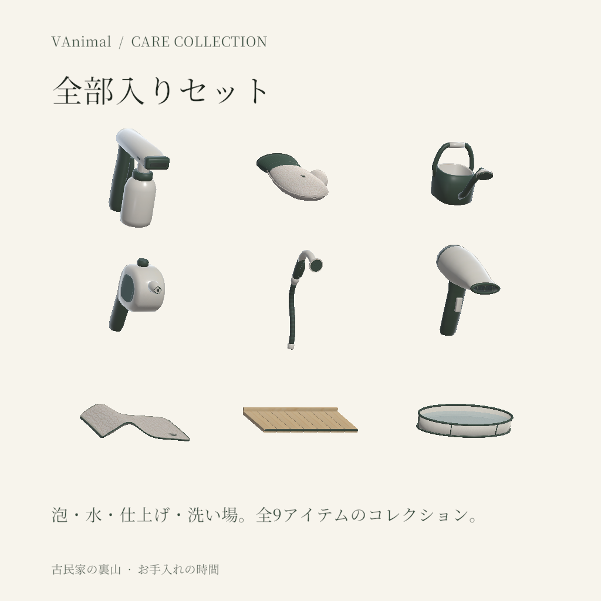

# VAnimal お手入れ道具 — 機能から再設計した9品

2026-10-13 / wash-premium 0.5.0。9品のモデルをUnityへ反映し、商品一覧5枚とワールド内の単品・セット写真を更新。対象版の外観はユーザー確認前、VRChat実機の握り・描画も未確認。

## Listing画像

1024×1024 PNG、価格なし。画像はUnityに導入した実モデル。セット2／3／2／2品、全部入り9品。大きさは各枠に合わせているため実寸比較ではない。

[泡](01-foam.png) / [水](02-water.png) / [仕上げ](03-finish.png) / [洗い場](04-station.png) / [全部入り](05-complete.png) / [5枚ZIP](wash-listings-1024.zip)

## 一品ずつの判断

特定商品やブランドの写真を形の参照にせず、**目的 → 手や犬との接点 → 水・風・力の通り道 → 構造 → 輪郭と材質**で決めた。既存モデルは持つ点・噴射点・取付点の互換性の入力として使用。

| 製品・詳細画像（Blender） | 形の理由 | 三角形 |
|---|---|---:|
| [泡銃](products/FoamCannon.png) | 洗剤を持つ下の容器と、泡を広げる上の混合部・横長口を分ける | 1252 |
| [肉球ミトン](products/PawMitt.png) | 手の入る袋・親指・厚い接触面を形で示す。[袖口](products/PawMitt-cuff.png) | 1012 |
| [じょうろ](products/WateringCan.png) | 低い貯水胴、開いた給水口、重さを支える持ち手、立ち上がる注ぎ口 | 976 |
| [水鉄砲](products/WaterPistol.png) | 貯水部と単一の小さな出口。窓は実際に胴が開いた別部材 | 1008 |
| [ホース](products/Hose.png) | 継手から握り、曲がった流路、広い散水面へ連続させる | 1856 |
| [ドライヤー](products/Dryer.png) | 吸気側から送風側へ絞る胴と、下に分かれた握り | 1348 |
| [タオル](products/PatternTowel.png) | 支える部分から垂れる曲面、角丸と縁の厚みで布にする | 2240 |
| [檜台](products/HinokiBath.png) | 排水する板の隙間と荷重を支える桟。[裏面](products/HinokiBath-underside.png) | 1064 |
| [プール](products/PoolBath.png) | 防水内張り・底枠・支持リブ。洗う側の前縁を低くする | 2358 |

共通性は深緑の耐水・保護層、生成りの芯・ケース・布、荷重を受ける木、柔らかい接触縁で作る。色面積と輪郭は用途に従って変える。じょうろは側面も支える耐水外殻を緑、上の持ち手の芯を生成りにした。架空の調整ダイヤルや装飾的な金属部を増やしていない。

## 確認範囲

- 9品合計13,114tri（旧15,958tri、約18%減）。道具2600tri・設備4000triの予算内。
- 保存blendとFBX再読込の位置・UV・面の向き・corner normal、退化面・UVを検証。
- 既存.metaを保持し9FBXだけ置換。9Prefab・36シーンモデルのMesh GUID/fileID、材質、階層、TRS、アンカー参照を保全。
- 4洗い場の28品分のPickup範囲を更新。proxyとUdon backing、選択中Colliderを別検査。
- [実シーンの材質・配置](evidence/station.png) / [写真選択UI](evidence/board.png)。Editモードの撮影で、使用中の犬やVRの握りは含まない。
- 独立6担当（U/D/M/X/P/V）で用途・造形・技術・保守・要求範囲をレビュー。[指摘と対応](review.md)。
- 最終C#コンパイル0エラー、Selection/Integration検査PASS。保存再読込後も28品分のbounds/backingと参照保全を確認。[検証集計](evidence/validation.json)。シーンの変更は4selectorのboundsとbacking、8個のPickup Colliderの中心/大きさのみで、追加削除0。[保存差分](evidence/scene-scope.json)。

実シーン写真には既存の草がプール内へ出る箇所、Editorでは補われないUIの一部字形が見える（既存設計はVRChatクライアントのフォールバックを使用）。今回のモデル更新では地形・植生・共有フォントを変更していない。ワールド統合の残件として、実機の左右の握り、ミトンと手、出口とエフェクト、犬と台の大きさ、透明描画と併せて確認する。

## 原本・履歴

原本は `C:/work/unity/vrc-asset-lab/assets/wash-premium/` の `scripts/models_v05_*.py`、`source/generated/0.5.0/`。設計理由は `design/2026-10-13/README.md`、再生成手順は `handoff.md`。新規の外部素材・商品写真・画像生成の製品案は使っていない。既存アトラスの出所記録はラボ制作票を引き継ぐ。

[更新前の写真](../2026-10-13/README.md) / [更新前の6ロールレビュー](../2026-10-13/model-review.md)。出力と導入FBXの対応は[manifest.json](manifest.json)。販売登録・アップロード・コミットは行っていない。
