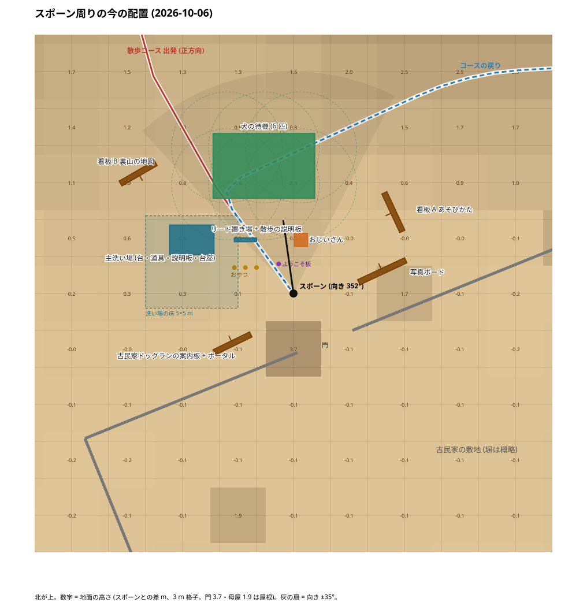
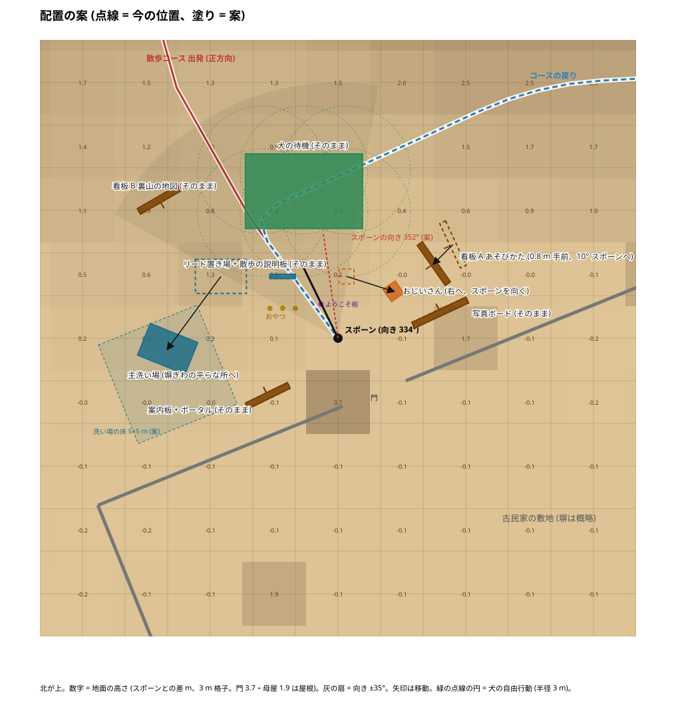
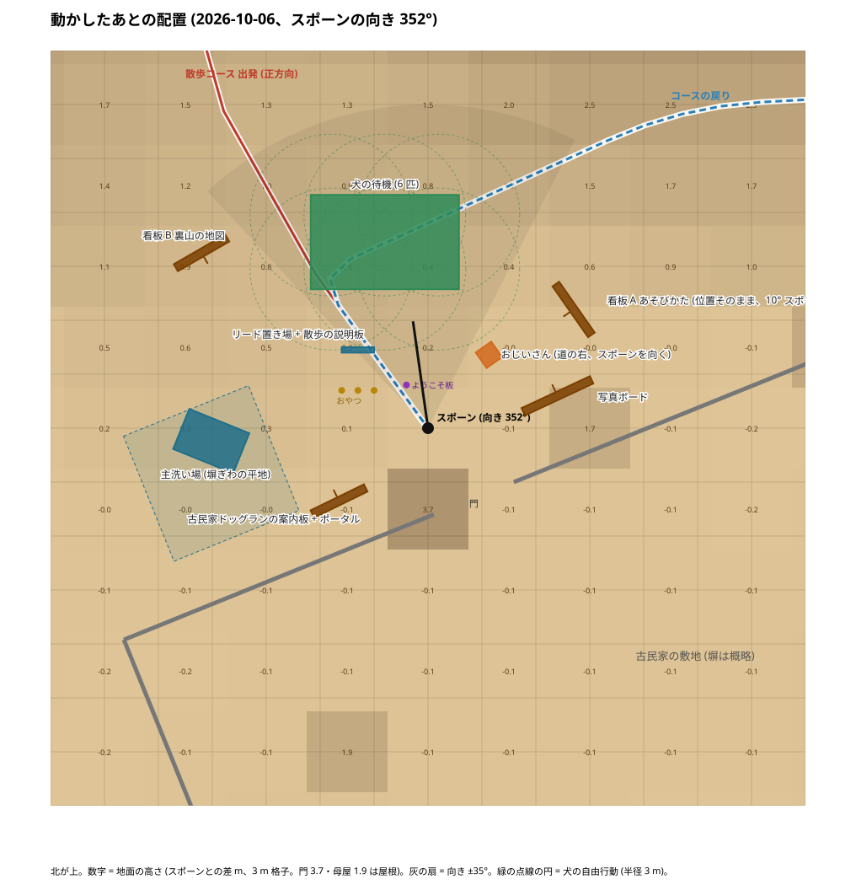

# スポーン周り (門前) の配置の検討 — 2026-10-06

メディアフィックス版 (配信者・宣伝動画の制作者へ渡す版、今週後半) の前に「看板のレイアウトと場所を整える」(2026-10-06 ユーザー) ための調査と案。実際に動かす作業はこの文書の §5 の順で、ユーザーが案を選んでから行う。

関連: [看板の設計 (位置の正本)](2026-10-02-guide-boards.md) §3、[IMP-UI-002](../development/issues/IMP-UI-002-guide-board-capture-instructions.md)、[DES-UI-004](../development/issues/DES-UI-004-walk-destinations-and-boards.md)、[IMP-WLD-006 門の案内板](../development/issues/IMP-WLD-006-farmhouse-portal-board.md)、[IMP-ENV-007 主洗い場](../development/issues/IMP-ENV-007-main-wash-station.md)。

## 1. 調べ方

- 一時 Editor スクリプト (`KH_TempSpawnSurveyEditor`、撮影後に削除) で、スポーン `KH_Entrance` (47.64, 1.61, 40.08、向き 334°) の目の高さ 1.62 m から **36° ごとに 10 枚** (FOV 70、1600×900)、上からの正射影 2 枚 (±22 m・±45 m)、半径 45 m の物の位置・大きさ・方位、地面の高さ (3 m 格子、レイキャスト)、周回コースの節点を取った。
- Edit モードの昼の描画で、VR・実機・夜の見え方ではない。
- 画像は [evidence/2026-10-06-spawn-layout/](evidence/2026-10-06-spawn-layout/) (800 px に縮小した JPEG)。地図は同じ場所の `layout-current.svg` (±14 m)、`layout-current-wide.svg` (±30 m)、`layout-proposal.svg`、`layout-proposal-wide.svg`。

## 2. 今の配置

座標はワールド (x, z)。「スポーンから」は水平距離と方位 (北 0°、時計回り)。「向き」は根の yaw (看板は表が yaw + 180° を向く)。「地面」はスポーンの地面との差。

| もの | 位置 (x, z) | スポーンから | 向き | 地面 | 備考 |
|---|---|---|---|---|---|
| おじいさん `KD_ShopKeeper` | (48.0, 43.0) | 2.9 m・7° | 270° (西向き) | ±0 | **道の真ん中、スポーンの真正面** |
| リード置き場 `KH_LeashRack` + 散歩の説明板 | (45.0, 43.0) | 3.9 m・318° | 0° | +0.3 | 説明板は黒板調。出発する道の左の縁 |
| 主洗い場 `KH_WashStation` (台・道具・説明板・すのこ・5×5 m の床) | (42.2, 43.0) | 6.0 m・298° | 0° | +0.3〜+0.6 | **斜面の登り始めに乗っている** (床の北側が 0.5 m 高い) |
| 看板 B「裏山の地図」 | (39.2, 46.6) | 10.7 m・308° | 330° | +1.0 | 洗い場と説明板の後ろに重なって見える |
| 犬の待機 (6 匹、`KH_Roam_*` 半径 3 m) | x 44〜48、z 46〜48 | 6〜9 m・335〜3° | — | +0.4〜+0.8 | 正面の斜面 |
| 看板 A「あそびかた」 | (53.0, 44.5) | 6.9 m・51° | 65° | +0.5 | **スポーンの向きから 77° 右 = 最初の視野に入らない** |
| 写真ボード `KH_PhotoBoard` | (52.4, 41.2) | 4.9 m・76° | 155° | ±0 | 塀の前、門の右 |
| 古民家ドッグランの案内板 + ポータル | (44.3, 37.4) | 4.3 m・231° | 154° | ±0 | 塀の前、門の左 |
| 門 `KH_GateBlock` | (48.7, 37.8) | 3.5 m・154° | 334° | — | 塀は門から東北東 / 西南西 (約 26°) へ |
| おやつ `KD_TreatHome_0〜2`・ようこそ板 `KD_WelcomeSpot` | (44.4〜45.6, 41.5)・(46.9, 41.7) | 2〜3 m | — | ±0 | リード置き場の手前 |

地面: 門の前から南・東は平ら (差 ±0.1 m)。**北へ 6 m で +1 m、12 m で +3 m、18 m で +4 m** の登り。西も 10 m で +1 m、20 m で +3 m。周回コースは正方向がスポーンから北北西へ登り (節点 1〜3 は (43.5, 45.8) → (40.0, 51.9))、戻りは東北東から (49.5, 48.6) → (44.0, 45.7) を通って門前へ降りてくる。

## 3. 写真で見えたこと (スポーンから、向きごと)

| 枚 | 向き | 見えるもの | 気になる点 |
|---|---|---|---|
| [00](evidence/2026-10-06-spawn-layout/ring-00-yaw-334.jpg) | 334° (正面) | 左半分に洗い場の台・すのこ・黒い説明板・リード台・看板 B が重なる。中央奥に犬。右手前におじいさん | **左に 5 つが重なって散らかって見える。** 看板 A は視野にない。すのこが地面に落ちた板に見える |
| [01](evidence/2026-10-06-spawn-layout/ring-01-yaw-010.jpg) | 10° | おじいさんが正面 3 m (横向き)、その後ろに犬。右端に看板 A の端 | おじいさんがスポーンの目の前で道を塞ぐ |
| [02](evidence/2026-10-06-spawn-layout/ring-02-yaw-046.jpg) | 46° | 看板 A が正面 7 m。右に写真ボードと塀 | 読める距離ではない (歩いて寄る前提)。A と写真ボードの間隔は良い |
| [03](evidence/2026-10-06-spawn-layout/ring-03-yaw-082.jpg) | 82° | 写真ボード (空の枠) と塀、門の屋根 | 写真ボードは何も貼られていないと枠だけに見える (仕様どおり) |
| [04](evidence/2026-10-06-spawn-layout/ring-04-yaw-118.jpg)・[05](evidence/2026-10-06-spawn-layout/ring-05-yaw-154.jpg) | 118°・154° | 門が目の前 | スポーンから門まで 3.5 m。門の位置は変えない |
| [06](evidence/2026-10-06-spawn-layout/ring-06-yaw-190.jpg)・[07](evidence/2026-10-06-spawn-layout/ring-07-yaw-226.jpg) | 190°・226° | 門の左の塀と「古民家ドッグラン」案内板 | 門の左右に案内板・写真ボードが対になって、ここは整っている |
| [08](evidence/2026-10-06-spawn-layout/ring-08-yaw-262.jpg) | 262° | 案内板、西の斜面、右に洗い場の台と看板 B | 洗い場の台が斜面の縁で宙に浮いて見える角度がある |
| [09](evidence/2026-10-06-spawn-layout/ring-09-yaw-298.jpg) | 298° | 洗い場・すのこ・看板 B・説明板・リード台・犬が一列に | 同じ方向に設備が並び過ぎている |

上面: [±22 m](evidence/2026-10-06-spawn-layout/map-near.jpg)・[±45 m](evidence/2026-10-06-spawn-layout/map-far.jpg)。

まとめると、問題は 3 つ。

1. **正面の左に設備が集まり、看板 B が洗い場と説明板に隠れる。** 右半分は犬とおじいさんだけ。
2. **おじいさんが道の真ん中・スポーンの 2.9 m 前に立つ。**
3. **看板 A「あそびかた」が最初の視野 (±35°) の外。** 犬の待機の輪 (半径 3 m、看板は 3.3 m 以上離す条件) が正面を占めるので、A を正面に持ってくる余地は無い。

## 4. 案

犬の待機・コース・門・写真ボード・案内板は動かさない (犬の輪とコースは散歩の仕組みに関わる。門の左右は整っている)。動かすのは 3 つ + スポーンの向き。

| もの | 今 | 案 (x, z・yaw) | 理由 |
|---|---|---|---|
| **主洗い場** (根ごと: 台・道具・説明板・すのこ・床) | (42.2, 43.0)・0° | **(39.6, 39.6)・22°** = スポーンから 8 m 西、塀ぎわの平らな所 (地面 ±0)。台は塀と平行、表が道を向く | 斜面から降ろす (すのこ・床が平らに乗る)。正面の左の重なりが解ける。散歩から戻って門前で洗う流れは変わらない (門から 9 m) |
| **おじいさん** | (48.0, 43.0)・270° | **(50.2, 42.3)・235°** = スポーンの右前 3.4 m、スポーンを向く | 道から外す。右側にいることで、右の看板 A へ視線が流れる |
| **看板 A「あそびかた」** | (53.0, 44.5)・65° | **(52.3, 44.0)・55°** = 0.8 m 手前、表を 10° スポーンへ | ほぼそのまま。犬の輪 (3.3 m 以上) と写真ボード (2 m 以上) の条件で、これ以上は正面へ寄せられない |
| **スポーンの向き** (任意) | 334° | **352°** (北) | 犬が中央、左端にリード台・看板 B、右端におじいさん・看板 A が入る (VR の視野 ±45° で)。334° のままだと A は視野の外 |
| 看板 B・リード台・説明板・おやつ・ようこそ板・写真ボード・案内板 | — | そのまま | 洗い場が移ると、左は「リード台 + 説明板」と奥の「看板 B」の 2 つになり、重ならない |

案のあとの見え方 (スポーンから 352° を向いて): 中央に犬 6 匹と登り道、左に リード台と説明板 (4 m)・その奥に看板 B (11 m)、右におじいさん (3.4 m) と看板 A (6 m)、振り返ると門と左右の案内板・写真ボード、西の塀ぎわに洗い場。

条件の確認 (看板の設計 §3-2 の基準で、案の位置から計算):

| 条件 | 基準 | 看板 A (案) | 洗い場 (案) | おじいさん (案) |
|---|---|---|---|---|
| 周回の道から | 1.8 m 以上 | 3 m 以上 | 4 m 以上 (戻り道 (44.0, 45.7) まで) | 2.5 m 以上 |
| 犬の自由行動の中心 (半径 3 m) から | 3.3 m 以上 | 4.7 m (ラブ (48, 46)) | 6 m 以上 | 4.3 m |
| スポーンから | 3.0 m 以上 | 6.0 m | 8.0 m | 3.4 m |
| 他の設備から | 2.0 m 以上 | 写真ボード 2.8 m、おじいさん 2.7 m | おやつ・案内板の読む位置まで 1〜2 m (**Guide/2 で要確認**) | ようこそ板 3.4 m |
| 塀から | — | 5 m | 床の南端まで約 2 m (塀の位置は概略。Unity で確認) | — |

**もっと大きく変える案 (今回は勧めない)**: 犬の待機の輪を北へ 3 m ずらして、看板 A をスポーンの正面右 (brg 15°) に置く。犬の `KH_Roam_*`・`KD_TreatHome`・歩行の検査 (Walking/Verify、Course/100) に手が入るので、フィックス前には向かない。

## 5. 動かすときの手順

1. ユーザーが §4 を選ぶ (スポーンの向きを変えるかも)。
2. Unity で根を動かす: `KH_WashStation` (子ごと)、`KH_Dogs/KD_ShopKeeper`、`KH_GuideBoards/Asobikata`。看板は Guide/1 の再実行で x / z / yaw が保たれる (作成時だけ設計位置を使う。`KH_GuideBoardsEditor.Asob.createXZ` と [看板の設計 §3-1](2026-10-02-guide-boards.md) の座標は合わせて更新する)。洗い場は Wash のビルダーが根の位置を変えないことを実行前に確認する。
3. スポーンの向きを変える場合: `KH_Entrance` の yaw と、それを参照して置く `KD_WelcomeSpot` (ようこそ板、yaw 334) と写真ボードの置き方 (`KH_PhotoGalleryEditor.Place` がスポーンの前方を使う) を見直す。
4. 検査: Guide/2 (看板の置き場所の条件)、Wash/12 (洗い場)、Course/81 TRAVEL_OK、Photo/2。そのあと保存・コミット。
5. この文書の撮り方でもう一度 10 枚撮って、前後を並べて見る (撮影は `Tools/KominkaHillside/Guide/15 - Survey Entrance`。出力は `Temp/spawn-survey/<utc>/`)。

## 6. 実施 (2026-10-06、ユーザー「推奨案で。スポーンの向きも変更で」)

一時 Editor スクリプト (削除済み) で根を動かし、地面の高さは「物を一時的に無効にしてレイキャスト → 元の地面からの高さを保つ」で据えた。

| もの | 動かした先 | 案との違い |
|---|---|---|
| 主洗い場 (子ごと) | (39.60, 1.83, 39.60)・22° | 案どおり。Wash/11 で据え直し・`Call.standYaw` を更新 |
| おじいさん | (49.90, 1.60, 42.80)・235° | 案の (50.2, 42.3) から 0.6 m 北西へ。写真ボードの置き場所の条件 (Photo/2: 設備から 2 m 以上) に 1.64 m で掛かったため |
| 看板 A | (53.00, 2.02, 44.50)・55° | **位置はそのまま、向きだけ 10° スポーンへ**。案の (52.3, 44.0) は写真ボードから 0.25 m (< 0.3) で Photo/2 に掛かったため |
| ようこそ板 `KD_WelcomeSpot` | (47.39, 2.97, 41.86)・352° | スポーンの前 1.8 m (向きに追従) |
| スポーン `KH_Entrance` | 向き 334° → 352° (位置はそのまま) | 案どおり |

検査: Wash/11 → Wash/12 VERIFY_OK (5316)、Course/80 → 84 → 27 → Course/81 TRAVEL_OK (旅の着地の立入禁止円 13 を更新)、Guide/1 → Guide/2 GUIDE_BOARDS_OK (653、WARN 3 は従来どおり: A の地形の起伏 0.60 m、Paper_Shop の余白、es の文字)、Photo/2 PASS。Guide の「門の線」の判定はスポーンの向きを基準にしていたので、門 `KH_GateBlock` の向きを基準にするよう直した (`KH_GuideBoardsEditor.cs` / `.Verify.cs`。スポーンが 352° を向いても門の案内板の判定が変わらない)。看板 A の設計位置の定数 `Asob.createYaw` を 55 に更新。撮影ツールは `Guide/15 - Survey Entrance` として恒久化 (`KH_EntranceSurveyEditor.cs`)。

動かしたあとの 10 枚: [evidence/2026-10-06-spawn-layout/after/](evidence/2026-10-06-spawn-layout/after/)。地図: `layout-after.svg` / `layout-after-wide.svg`。

見え方 (スポーンから 352°): 中央に犬 6 匹と登り道、左にリード台と説明板、その奥に看板 B が隠れずに見える。右端におじいさんと看板 A。おじいさんは A の 11° 左前に立つので、A を見る角度では彼が板の左を少し隠す (ring-01)。塀ぎわの洗い場は平地に乗った。**Play・VR での見え方は未確認** (チェックリスト A0-53)。

## 7. 記録

- 2026-10-06: 調査と案を作成。同日ユーザーが推奨案とスポーンの向きの変更を採用し、§6 のとおり実施。Play は未。計測ボタンと `KH_PerfProbe` は同日に撤去済み ([VER-ENV-002](../development/issues/VER-ENV-002-scenery-performance.md))。
