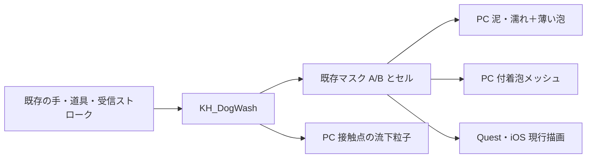

# PC版シャンプー泡の立体化 — 詳細設計

> 対象: DES-DOG-011
> 2026-10-11 / 実装候補 v2。ユーザー確認済みの範囲は **PCのみ改善、Quest・iOSは現行維持**。ローカル実装・検査は§14、見た目と性能の採用判断は未了。

## 1. 結論と設計の境界

第一候補は **既存の細い泡の膜＋体に付着する丸いメッシュ＋すすぎ時だけの短命Mesh粒子**。PCの現行「泥・濡れ1パス＋泡4層」を「泥・濡れ1パス＋薄い泡2層＋立体泡1パス」へ置き換える候補を実装した。薄い泡1層の初案は全身比較で隙間が目立ち2層へ修正。追加するだけの案も切り分け用に残すが、第一候補は既存の上2層を置き換える。

付着泡をParticleSystemで全面管理すると、各粒の骨追従・体表UV・局所すすぎ・復元を別途扱う必要がある。Udon APIが無いから却下するのではない（必要な粒子APIは今回公開を確認した）。**粒ごとの毎フレーム処理を避け、既存のスキニングとマスクを使えること**を第一候補の理由とする。

決める対象は表現とその統合方法。泡の量、手の広がる速度、シャワーの当たり、清潔判定、写真の契機、洗浄のOwner・通信形式は変更しない。流体計算、泡同士の衝突・合体、床に溜まる泡、共有する粒子位置の同期は初回に含めない。粒子の落下は接触点付近の演出であり、消えた泡の質量保存ではない。

体験・見た目の正本は [core-concept](../core-concept.md) §1〜3、仕様は [game-design](../game-design.md) のお手入れ。経緯と代替方式比較は [調査Issue](../development/issues/DES-DOG-011-volumetric-shampoo-foam.md) §1・2、現行洗浄の契約は [方式設計](2026-09-30-dog-wash-design.md)。この文書はPC追加表現の設計を持つ。

## 2. 今回確認した実物と、確認できていないこと

### 2.1 設計前の読み取り調査条件と証拠（履歴）

- Unity 2022.3.22f1 / Worlds SDK 3.10.5。開始時HEAD `647974c`。他セッションが同じ作業ツリーで追加道具等を変更中のため、関連の未コミット変更を含む作業ツリーを読み取り、実行コード・シーンは編集しない。
- `scripts/unity-api.sh check` で本プロジェクトの `Assets` と接続先を照合。Editモードの `VRCDefaultWorldScene`、読み取り前後 `dirty=False`。Play・コンパイル・再構築・保存・描画試作は行っていない。
- [Editor読み取り記録](evidence/2026-10-11-pc-foam-research/editor-readonly.json) にAPI問い合わせと結果、メッシュの集計を保存。多項目一括evalの空応答、dogRoot配下のPet検索のnull、Animator曲線の空応答は失敗として残した。後続の成功した個別読み取りだけを下表の根拠にした。
- [数式・予算計算](evidence/2026-10-11-pc-foam-research/design-calculations.cjs) と [結果](evidence/2026-10-11-pc-foam-research/design-calculations.json) はNodeで実行。Unity描画・性能試験とは区別する。

### 2.2 現行の6匹（Editor内の洗浄shell参照を読み取り）

| 犬 | 元メッシュ頂点 / 三角形 | 骨 / BlendShape | Renderer scale | 現行泡の厚み m |
|---|---|---|---|---|
| コーギー | 3,672 / 6,548 | 33 / 14 | 50 | 0.032 |
| ダックス | 2,746 / 5,140 | 33 / 14 | 100 | 0.029 |
| ラブラドール | 3,485 / 6,320 | 33 / 14 | 100 | 0.059 |
| ポメラニアン | 2,011 / 3,764 | 31 / 14 | 100 | 0.022 |
| 柴 | 3,548 / 6,408 | 33 / 14 | 50 | 0.050 |
| サモエド | 2,455 / 4,596 | 33 / 16 | 100 | 0.057 |

全6匹ともsubmesh=1、SkinQuality=Auto、updateWhenOffscreen=False。シャワー半径0.07 m、rinseReach=1.7。柴の毛は `Hidden/Sigmal00/Uzumore/FurTwoPass` queue=3000、洗浄shellは3010。

元のbind mesh面積に `meshToWorldScale²` を掛けた概算は、柴0.8182㎡、ポメ0.2624㎡、サモエド1.3121㎡。これは顔・裏側等も含み、アニメーション中の表面積や見える泡面積ではない。**同じ粒数を6犬種へ一律コピーしない理由**とする。

柴の14 BlendShapeには `metozi/egao` 以外に `onaka/tail1/tail2/maru/mimi` 等もあり、全フレームの位置deltaが非ゼロの頂点は1,967、残り1,581。現状の体Rendererには `tail2=100`、他13形状=0が設定されていた。元頂点をそのままコピーしただけでは、この静的な尾の変形にも合わない。実行時は `KD_DogPetController` が少なくとも `metozi/egao` を書く。Animatorの全曲線は今回取得できておらず、動く形状がこの2個だけとは確定しない。

### 2.3 Udon APIの公開確認

ノードレジストリで次の9件を確認。Wrapper DLLにも粒子・材質の対応文字列がある。未公開と既知の `TMP_Text.font` setterが落ちることを対照にした。

| API | 結果 / 設計上の使い方 |
|---|---|
| ParticleSystem.Emit(EmitParams, int) | 公開。流下粒子の位置・速度・寿命を指定する |
| EmitParams.position / velocity / startSize / startLifetime / applyShapeToPosition | 5 setterとも公開。受信イベントの接触点から出せる |
| ParticleSystem.particleCount | 公開。犬ごとの生存数を接触時に確認可能 |
| ParticleSystem.SetParticles(Particle[], int) | 公開。全面粒子案の追従実装は可能性があるが、更新負荷は未測定 |
| Material.SetShaderPassEnabled(string, bool) | 公開。ただし既存のFOAM1だけをName指定で止められる根拠にはしない（§5） |

公開確認は新実装のUdonSharpコンパイルやVRChat実行の合格ではない。EmitParamsの構築・設定・Emitまでの小さい実コードのコンパイル確認は実装工程G0に残す。

## 3. 全体構成とデータの責任

追加RT・追加カメラ・GPU→CPUの画像読み戻し・粒単位のUdonBehaviourは作らない。付着泡は犬ごとに結合メッシュ1個、Renderer1個、描画材質1個。流下は犬ごとにParticleSystem1個、共有の低ポリ球メッシュと材質を使う。通信は既存 `NetStroke` と状態復元に乗る。距離で泡量を変えない。

## 4. 付着泡の形状とスキニング

### 4.1 生成データ

原本はEditor生成コード＋犬種設定＋元meshのGUID/local fileIDと検証用hash。購入mesh・rigは変更しない。1個の丸い山を **lobe** と呼び、粒数予算はlobe数で数える（複数lobeを1塊として数えて予算を隠さない）。

候補位置は体meshの元頂点から選び、位置・UV0・法線・実効boneWeightsをコピーする。同じ位置でもUV seamや部位が異なる頂点を無条件に統合しない。三角形面積から頂点の担当面積を配分し、密集した元頂点へ偏らないよう面積重み＋最小間隔で選ぶ。物理的に近い別脚・腹へ隣接が飛ばないよう、メッシュ接続と部位区分を使う。

元頂点に限定する理由は、任意の三角形内位置とweightsを別々に補間すると、skin後の面を厳密に追従しないため。`Skin(Σbᵢpᵢ, Σbᵢwᵢ) ≠ ΣbᵢSkin(pᵢ,wᵢ)`。4 cmの例で骨回転差90°なら2 cmの差が出る数式例を証拠へ残した。これは実犬の誤差実測ではない。

### 4.2 第一試作の頂点構成：中心をskinし、球を頂点シェーダーで展開

各lobeの42頂点／80三角形（1段分割icosphereを想定）の **POSITIONは全て同じ体表anchor** にする。全頂点に同じweights・bindposes・元体表法線を持たせる。球方向はskinされないUV属性に保持し、変形後の中心からworld mで展開する。

| 属性 | 値と用途 |
|---|---|
| POSITION / NORMAL | 元体表の同一anchor位置／法線。Unityの標準skinで中心と毛面の向きへ追従 |
| BoneWeights / bindposes | 元anchorと同じ実効weights。元RendererとQuality・骨順・rootBoneを合わせる |
| TEXCOORD0.xy | anchorの体表UV。既存マスク参照 |
| TEXCOORD1.xyz / w | 単位球方向（world軸として使用）／最大半径m |
| TEXCOORD2 / 3 | 周囲4点の体表UV（各float4に2点）。§4.4の境界判定 |
| TEXCOORD4 | 部位ID・形状seed・毛面offset m・予備。意味を生成設定の版と一緒に固定 |

中心 `c = objectToWorld(skin(anchor)) + skinNormalWorld × furOffset`、頂点 `p = c + directionWorld × r × growth`。球なので方向の骨回転を必要としない。NORMALを球方向としてskinする案も相談したが、2骨の180°混合で方向長が0になり得るため、初回は方向をworld軸固定にして退化を避ける。球に沿った陰影はdirectionWorld、根元の暗さには体表法線を使う。犬が回転しても模様が泳がないよう、模様はlobe固有seedによる明暗に留める。楕円・方向性の強い塊への拡張は別の追従設計を要する。

**生成前の三角形は面積0になる特殊メッシュ**なので、これは実機成立確認前の方式案。Unity Mesh assetを直接生成し、FBX経由やRecalculateNormals、頂点溶接を使わない。保存再読込、ビルド後のindex・UV保持とshader展開をG0で確認する。通らなければ、この方式のまま密度や描画品質を調整せず、通常の非退化メッシュ方式へ戻す（§10）。

### 4.3 BlendShapeと関節

第一段階は頭（部位7）・目口・耳先を立体lobeの対象外とし、既存の薄い泡と頭の上限0.35を維持する。胴・脚・背中・腰・尾の付け根を対象とする。これは犬の顔を読めるまま全身のシルエットをもこもこにするためで、全身泡の確認から脚や腹を除外する免除ではない。

生成前にbodyの現在のBlendShape値と、Animator/Udonが実行時に変える形状の一覧を採取する。静的形状（例: 柴tail2）はその設定の変形をanchor位置・法線へ反映して生成し、設定hashが変われば再生成を要求する。実行時に変形する頂点は候補から除外する。動的形状一覧が取れない場合、全形状の影響頂点を除外した最小試作に留め、**そのまま全身用の採用に進まない**。

除外で背中・腹等の必要範囲が不足するなら、中心に元anchorのBlendShape deltaを複製する方式へ拡張する。動的weightは既存の表情を書き込む箇所から、PC専用Rendererにも同じ値を渡す案を優先し、粒ごとの更新や全14〜16形状の毎フレームポーリングを標準にしない。Animatorが別に変える形状の取り込みも含めて設計・検査を追加する。これが高コストなら該当領域は小さい通常skinned mesh形状で比較する。未知の動的形状を「動かない」と仮定して採用しない。

Boundsは元bodyの可動範囲に最大半径・毛面offsetを加え、実効スケール50/100を考慮してlocalへ変換する。非一様scaleがあれば平均値だけで余白を計算せず、全軸を覆う変換を使う。`updateWhenOffscreen=false`を起点とし、視界端・背面・再表示・ブルブルで欠けないことを確認する。

### 4.4 泡立ちと、すすいだ帯へのはみ出し

同じUVを読む球は、fragment段でも球全体の泡量が同じになる。中心だけのUVで「球の右半分だけすすげる」とは設計しない。

主案は **小さいlobe＋周囲の泡量に応じた球全体の縮小＋正確な帯を描く薄い泡**。各anchorの周囲、lobe半径相当の体表4方向を同じ接続面上で探索し、UVを焼く。seamは対応する三角形のUVへ移し、別脚へ探索しない。支点が得られない箇所は半径を下げるかlobeを作らない。

頂点で5点のマスクGを読み、部位上限適用後の最小値 `Fmin` から `growth=smoothstep(0.18,0.75,Fmin)` を仮設定する。半径にgrowthを掛け、下端ではfragment clipで完全に消す。値はPC表現だけの提案で、セルや洗浄速度には反映しない。薄い泡は元マスクを元のUVで描くため、小さい塗り始めと帯状の境界を担う。

この方法は保守的に球ごと消すため、すすぎの縁で立体部分が少し早く低くなる。逆に5点の間を通る極細の帯は取りこぼし得る。**厳密な局所切断は保証しない**。実際のシャワー半径7 cmの帯、細い試験帯、関節・UV seamで「消した毛の上に泡が残る」違和感が出たら、半径縮小→周囲8点→配置見直しの順で比べる。点数を増やしても不適なら主案を棄却する。大きな輪郭だけを成功として扱わない。

## 5. 描画と材質

新PC薄膜shader `KH_WashShellPCThin.shader` は、元 `KominkaHillside/Wash Shell` の `BASE`・`FOAM0`・`FOAM1` を `UsePass` で再利用する。初案の2passでは根元のFOAM0が毛に隠れ、立体球の間に隙間が目立ったため、全身比較後に3passへ変更した。立体泡と合わせて4pass（流下は別）。元材質からEditorで値を複製・照合し、PC泡の下地だけは影色を淡くし、白毛用の強い平面コントラストを弱める。泥・濡れの設定は継承する。配列は現行同様Startで設定する。旧shaderのモバイルSubShaderは変更しない。UsePassの3pass解決・実描画・PC bundle後の再描画をG0で確認する。

`Material.SetShaderPassEnabled("FOAM1", false)` で既存層を個別停止する案は採らない。APIは公開だが [Unity仕様](https://docs.unity3d.com/2022.3/Documentation/ScriptReference/Material.SetShaderPassEnabled.html) はLightMode tagを指定しており、現行BASE/FOAM0〜3は全てForwardBase。Nameが違うだけで個別に止まるとは言えない。[UsePass](https://docs.unity3d.com/2022.3/Documentation/Manual/SL-UsePass.html) は名前付きpass再利用の仕組みとして使い分ける。

立体泡shaderは1 pass、Cull Back、ZTest LEqual、ZWrite On、基本Blend Off、影なし・反射probeなし・GrabPassなし。不透明寄りの白〜淡い既存色、柔らかいSH＋主光の陰影を使い、強い光沢・屈折は初回に入れない。追加のピクセルノイズの反復計算は避ける。粒の境目が真珠に見えたら、照明・大小の重なり・根元の埋まり方を修正する。

描画順は柴の毛3000／薄膜3010を踏まえ、立体泡3011を初期比較値とする（遅いqueueでもBlend Offなので透過合成はしない）。透明な水・毛・既存粒子との順序はqueueだけで保証できない。立体泡を不透明queue側へ置く案とも代表画像で比べ、どちらでも水が泡の後ろへ誤って消える等が残れば採用しない。depthを書かない水との前後が主な確認点。両眼で同じ球形・位置が見えるよう、既存のstereo instanceマクロを引き継ぐ。

## 6. 流下演出

`KH_DogWash.ContactEffects` の ToolShower かつ `foamHere>0.2` を起点とする。ローカル操作と他人の受信操作の両方が既にここへ入り、自分の受信echoでは再生を重複しない経路がある。新しいネットワークイベントは追加しない。ToolHand/Bottleの既存 `foamPuff` はそのまま。

| 項目 | 初回提案 |
|---|---|
| 発生上限 | 1匹16粒、6匹合計96粒。犬別上限×6を全体上限として明記し、共有managerは作らない |
| 発生率 | 最大12粒/秒/犬。接触時間から作る要求と、犬単位の実時間による発生許可を分離する（下記）。`foamHere`で弱め、残数をparticleCountで確認 |
| 粒の形 | 20〜80三角形の小球、World空間、サイズ0.008〜0.025 m、寿命0.25〜0.6秒 |
| 動き | 接触面の外向き＋下向きの初速、弱い重力、寿命で縮む。不透明材質を起点に、消滅は縮小で処理 |
| モジュール | 自動Emission / Collision / Trails / Lights / SubEmittersなし。EmitParamsで位置・速度・寿命を指定。applyShapeToPosition=false |

発生要求は接触ごとの `sec × 12 × foam係数` をaccumulatorへ足して整数粒にする。ただし**全操作者で犬ごとの次回発生可能時刻を1つ共有**し、`Time.time >= nextEmitAt` かつ生存16粒未満の場合だけ1粒Emitし、`nextEmitAt = Time.time + 1/12秒` とする。複数人・複数部位から同じフレームに要求されても許可は1回。許可されなかった整数分は捨て、小数分だけ繰り越す。無接触0.2秒超またはClearで小数分をリセットする。遅延受信・休止時間分の発生枠は貯めず、12粒/秒は目標発生数ではなく上限とする。先に到着した接触を使うため位置・粒数は端末間で一致を要求しない。既存foamPuffのaccumulatorとは分離する。

接触経路には正確な毛の表面法線が渡っていない。新規raycastや全mesh走査は足さず、対象部位Colliderの中心から接触点へ向く方向を外向きの近似とし、極小長なら下向き成分主体にする。位置は接触点から粒半径程度だけ外へ置く。毛へのめり込みや逆側への射出はG2で判断する。重力だけでは犬の中を通るため「体表を正確に伝う流体」とは呼ばない。

`foamHere` は粗いセル近傍の値であり、GPUマスクや消えたlobeの実量ではない。帯の縁に小さな塊が落ちる因果を見せる用途に限る。すすぎ停止後は寿命で消滅、ワープ／リセット時は既存のepoch・復旧経路からClearする。Owner交代だけで過去の粒を発生し直さない。RTのRestore・Replayからも粒子をEmitしない。

## 7. 実行コードへの接続

実装は `KH_DogWash.PCFoam.cs` のpartialと、既存ファイルの少数の呼出点。新UdonBehaviourや新しいUpdate/LateUpdateを常設しない。追加フィールド・処理・呼出点を `#if !UNITY_ANDROID && !UNITY_IOS` でまとめて除外する。既存の同期変数・ネットワーク引数は増減しない。

| 既存の接続点 | PC側の責務 |
|---|---|
| Start | 既存shellの `.material` 取得より前に参照・設定版を検査。不成立なら保存したPC用旧材質参照へ `sharedMaterial` を戻して付着泡・流下を停止。成立時だけ追加Renderer.materialを1回取得し、部位上限・元のposMap等を設定 |
| Swap | `_cur`交換と同じ場所で立体泡材質もSetTexture。maskA/Bを固定参照しない。新Blitは不要 |
| 初期化／Restore／RT再生成 | 現在の `_cur` を再bindし、表示フラグを現在状態から再構成。Start順や遅延受信に依存した一度きりの処理にしない |
| Stroke / ReceiveStroke | 新しく泡を付けた場合は追加Rendererを即時有効化する。非Ownerのローカルmask更新をセル同期まで待たせない |
| EvaluateStateCells / EvaluateTime | 既存の集計にPC専用の「泡セルがある」を併せる。追加の毎フレーム256セル走査を行わない。泥・濡れだけの通常状態では追加Rendererを止める |
| ContactEffects | §6の条件に限り流下粒子を出す。別端末への送信やclean判定を書き換えない |
| リセット／epoch切替 | 粒子と発生accumulatorをClear。追加描画状態を再構成 |

**泡RendererのOFF判定:** 粗いセルが0でもローカルmaskに残り得るため、セル平均や経過時間だけでOFFにしない。泡付与・泡を含むRestore・泡セルの検出でON、泡なしRestoreまたは既存Decayの最終クリアBlit完了後にOFF。初案のfoamDrySeconds＋2秒は、別部位を洗い続けて乾燥が停止している場合と矛盾するため廃止した。すすぎ直後から既存クリアまでの残留skin負荷は計測に含める。追加GPU readbackは行わない。

PC用薄膜材質への変更はビルドコピーとStartの前置検査で行う。差替え前の元材質をPC専用の `pcFoamFallbackShellMaterial` 参照として必ず保持する。参照が無いbuildは検査で失敗させ、復帰を保証できないまま配布しない。Startの前置検査が失敗した場合は、その参照へ戻し、追加Rendererを無効化・粒子をClearしてから既存の材質キャッシュ取得とmask／配列の初期化へ進む。薄膜だけを残して成功扱いしない。

実行中のA/B切替を追加する場合は、材質を入れ替えた後に `_shellMat` キャッシュとmask・配列を再bindする専用試験処理を使う。古いキャッシュを残した単純差替えでは比較しない。

## 8. Quest・iOSを現行のままにする

シーン上は元のshell材質を保存し、PC専用の生成ルートと設定を別に管理する。ビルド対象によって **ビルドコピーだけ** を処理するEditor callbackを用意する。既存Terrain callback（order 1000）は流用せず、UdonSharpのproxy転記・除去（order 0）より前のorder（提案−1100）で処理する。対象は完全なscene.pathで限定する。

- PC: 必要な参照・生成版が揃った犬だけ、旧材質のfallback参照を保存してshell材質をPC薄膜へ。付着泡Renderer／粒子を残す。部品不足時はその犬のPC追加一式を外して現行へ戻すか、検証ビルドではfail fast。実行時検査失敗の復帰手順は§7。
- Android/iOS: PC専用ルート・参照（fallback用フィールドを含む）・PC材質をコピーから除去。既存shell・foamPuff・wash tuningは元のまま。元のshellが使用する旧材質そのものは除去しない。Udonの新CPU経路はコンパイルされない。
- `VRCSceneDescriptor.DynamicMaterials` 等にPC材質だけの参照が残っていないこと、元マスクや共有する元shaderを誤削除していないことを検査。実行時非表示だけで容量ゼロと扱わない。
- 既存同期BehaviourやNetworkIDを移動・再生成せず、PC-only UdonBehaviourも増やさない。ビルドコピーの参照切れIDと既存ID一致を確認し、跨端末のNetStroke互換を試す。

編集用の比較は非保存の試験シーン／コピーで行う。共有中の本番シーンをSetupでまとめて再構築しない。ビルド前後の元シーン差分ゼロ、Android/iOSでPC専用mesh/material依存ゼロを検収項目とする。

## 9. 数量・メモリ・性能の予算案

32〜64 lobeはG0の成立確認用であり、全身を覆う確定数ではない。半径2.5 cmの円面積を64個足しても0.126㎡、柴の全mesh面積の約15%にすぎず、重なりも考えると全面の保証はない。大きさの違う山と薄い泡の組合せで、128→192→256 lobeを比較する。最初から256を常設しない。柴では半径1.5〜4 cm程度を探索し、ポメ等は体格と毛の長さで小さくする。最終密度は画像と負荷の両方で選ぶ。

| lobe/犬 | 頂点 / 三角形 | 生成meshの概算容量（128 bytes/頂点＋16bit index） |
|---|---|---|
| 64 | 2,688 / 5,120 | 約0.36 MiB |
| 128 | 5,376 / 10,240 | 約0.71 MiB |
| 192 | 8,064 / 15,360 | 約1.07 MiB |
| 256 | 10,752 / 20,480 | 約1.43 MiB |

概算strideはPOSITION/NORMAL各12、UV群計72、weights＋indices32 bytes。実際のUnity stream・圧縮・CPU側コピー・GPU skin buffer・Read/Write・BlendShape等で変わる。256×6なら元データだけで約8.58 MiB。頂点属性を増やす方式なので、三角形だけで軽量と判断しない。初回の上限案は256 lobe/犬、6匹合計1,536 lobe、流下96粒。これで全身の見え方が満たせなければ、勝手に上限を上げず形状・方式と予算を再判断する。

6匹の元meshは計32,776三角形。単純な「三角形×pass」では現行5pass=163,880、現在の薄膜3pass＋付着泡1,152 lobe=190,488（約16%増、流下別）。生成数はコーギー160・ポメ128・ラブ256・ダックス160・柴192・サモエド256で、追加skinは合計48,384頂点／92,160三角形。**pass削減を性能改善とは読まない**。5点×頂点のマスク読み、画素の覆う範囲、両眼描画も異なる。省くのは上2層の画素ノイズであり、採否にはCPU/GPUの比較が必要。

負荷の暫定判定案は、同一PCVR条件で候補−現行のCPU/GPU各中央値が+0.3 ms以内、p95が+0.5 ms以内、90 Hzなら全体p95が11.1 ms以内（他refresh rateでは対応予算）。これは**測定前の提案**で、もともと予算を超える環境では「元が遅いから良い」にせず、候補の増分と既存の不足を分ける。測定揺れが閾値より大きければ判定不能とし、条件を固定して再測定する。ユーザーが負荷増を体感する場合は数値内でも見送る。

## 10. 比較案と棄却条件

| 案 | 目的 | 先に落とせる条件 |
|---|---|---|
| A 現行4層 | 体感・速度・マスク・通信の基準 | 常に残す。現行確認も新しい版で行う |
| D-add 現行＋立体泡 | 立体泡だけの増分を切り分ける | 完成案と取り違えない。GPU/CPU増分が大きければ早期終了 |
| D-replace 薄膜3pass＋立体泡＋流下 | 第一候補（全身比較で2→3passへ修正） | 退化mesh保持NG、体表追従NG、帯へのはみ出し・大きな穴、必要密度が予算超過なら棄却 |
| D-normal 通常の非退化skinned泡mesh | collapsed方式の保存／描画が通らない時の代替 | 局所的な成長・消失の質、同じ密度のskin負荷が許容外なら棄却。複雑な中心復元を無検証で足さない |
| C 全面Mesh粒子 | ParticleSystem更新・描画の比較 | 固定粒数の元頂点anchorを追い、SetParticlesのCPUとmask対応を計測。独自readbackや大量骨GameObjectが必要なら今回の優先順位を下げる |

Cの初回対照は柴・同じ球mesh・同じ数・同じ不透明材質・同じカメラで固定表示し、粒子の管理／描画コストを見る。CPU側で元頂点weightsによる中心を更新する固定配列方式を候補とし、体に追従しない静止粒子の性能を完成版の性能にしない。Cの局所マスク表示にはanchor UVを粒子のCustom Dataで渡す等が必要だが、該当APIとvertex streamの確認は今回未実施。Dが不成立／性能不足の場合にこの次の賭けを確認し、Cの完全実装を並行して先行させない。

## 11. 実装順と検収

| ゲート | 成果物 / 合否 / 作業範囲 |
|---|---|
| G0 方式の成立 | 柴の元頂点1〜数個、Edit用の非保存コピーで生成。属性／index／Bounds／非ゼロの正しい描画、マスク0・中間・1、UsePass3pass実描画、EmitParamsのUdonコンパイルを確認。保存再読込・PC bundle後にも保持。ここでfailedならD-normalへ |
| G1 面の範囲と追従 | 形状データ・動的BlendShape一覧・静的値・UV seam・5点supportを採取。背中・腹・脚・腰・尾根元の代表姿勢でanchorが浮かない。白毛・小型犬も少数表示し、顔を読めることを確認。必要部位を表現できなければ密度増量前に方式へ戻る |
| G2 柴1匹の体験 | 薄泡→全身→片側すすぎ→止水→追加泡→全身すすぎ。上・横・斜め、近接VR・Desktop、昼／夜。1cm試験帯と通常7cm半径のシャワー、首脚seam、顔、泡なしすすぎ、ワープ中断を確認 |
| G3 最小の性能A/B | 現行→D-add→現行→D-replace→現行。1匹／6匹、泡なし／全身／同時すすぎ、未使用、すすぎ直後のOFF猶予を測る。必要時だけCの最小対照へ。固定条件、ウォームアップ後30秒以上×3回を提案。CPU/GPU中央値・p95・drawcall・SetPass・vertices・粒数・メモリを同じ計測系で記録 |
| G4 配布境界・通信 | PCとAndroid/iOSのビルドコピー差分・専用依存除外・NetworkID一致。PC部品欠落／設定版不一致を試験コピーで注入し、Start前検査から旧材質4層へ戻ることを確認。2人同時、非Owner、Owner交代、途中参加、PC＋Quest/iOSで同じ洗浄状態。複数人すすぎでも発生間隔が1/12秒以上・生存16粒/犬以内、休止後の一斉発生なし。粒子数の端末間一致ではなく、接触場所と残泡の因果を確認 |
| G5 採否・6匹 | ユーザーが「全身もこもこ・流下が明確に良い」「洗い心地維持」と評価し、負荷予算内なら採用。6犬種の密度・半径・白黒毛を記録。NGなら現行へ戻し理由を残す |

Playが必要な工程では `vrc-review` の相談を経て `scripts/kh-harness-run.sh` から対象ケースだけ実行する。全体回帰は明示指示時のみ。PCVRの見た目・体感と通信／モバイル確認は `vrc-verification` に従って引き継ぎ、Editor画像を実機合格へ読み替えない。

実装の作業単位は (1)生成・描画の小試作、(2)マスク／流下の接続、(3)PC build分岐・復旧、(4)比較と6匹。子IMPは [IMP-DOG-052](../development/issues/IMP-DOG-052-pc-volumetric-shampoo-foam.md)。2026-10-11の実装候補とゲートごとの確認範囲は§14。実機未確認のまま全6匹の採用完了扱いにしない。

## 12. 制作票（生成アセット）

### 目的・用途と見た目

主分類BACKDROP_FX、犬に付着する操作反応。core-concept §1〜3のASMR・犬の顔の読みやすさを適用。丸い山が大小つながる形、柔らかい白、過剰な青・光沢を避ける。主洗い場と道中の洗い場、近接・昼夜・泡量別に確認する。

### 対象と予算

PC Built-in / D3D11のみ。6匹上限。数量・メモリは§9、視距離は実際の洗う位置をG2で記録。初回の仮カメラは泡から0.3/0.6/1.5 mで比較し、実利用の最短距離の確定値にはしない。

### 形状・寸法と作り方

Editorで元体meshから生成。球の山は§4、流下小球は§6。初回は新テクスチャ不要。Colliderなし、頂点の手続き的展開あり。距離LODは初回に追加せず、密度の違う比較用meshを別設定として生成する。

### 接続点・可動・適合

元bodyの兄弟Renderer、同じtransform/bones/rootBone/quality。静的形状値と動的BlendShapeの扱いは§4.3。目・口・耳先は薄膜に任せ、6犬種で脚・腹・毛長・尾の差を確認する。

### 材質・UV・テクスチャ

UVは絵の展開ではなく体表マスク参照と球方向データ。縮退POSITIONでもUV等が保たれることが検収項目。追加RenderTexture・カメラなし。薄膜は元pass再利用、立体／流下は各1材質、元の洗浄色と光を合わせる。

### ファイルと引き渡し

実装名: `Scripts/Editor/KH_PCFoam*.cs`（生成・検査・ビルド分岐）、`Scripts/KH_DogWash.PCFoam.cs`、`Shaders/KH_WashShellPCThin.shader` / `KH_PCFoam.shader` / `KH_PCFoamRunoff.shader`、`Data/Wash/PCFoam/`（犬別mesh・材質・設定）。いずれも `Assets/KominkaHillside/` 内。既存GUIDを維持して再生成、.meta同梱。配置だけを正本にせずSetupとVerifyが設定版を照合する。

### 参照元と権利

既存の購入犬のmesh/weights/UVを生成入力として扱い、元アセットは変更しない。今回新しい外部素材・画像・音源は取得していない。生成時に入力GUIDと由来・既存の利用条件記録を対応付け、派生アセットのワールド内利用範囲を確認する。外部へのmesh配布は今回の対象外。球primitiveとshaderコードは自作。

### 仮決め・未確定

collapsed meshの保存／PC単体bundle保持と動的BlendShape一覧は§14で確認。全面を満たす密度、すすぎ境界、queueと透明な水の前後、性能予算の実機妥当性は未確定で、上記ゲートで棄却できる設計とする。

### 確認結果

設計時の読み取り・API公開・数式計算に加え、§14の生成・描画・局所動作確認まで実施。PCVRの表現・性能と跨端末検収は未完了。

### 変更履歴

2026-10-11 v2: 6匹の実装候補と局所検査を追加。薄膜を3passへ、形状を高さ0.85・埋込み0.03へ調整。

2026-10-11 v1: 初回の調査案から、中心skin／固定UVの制約、静的tail2、部位と密度、UsePassによる上層置換、モバイルbuild除外、実装ゲートを具体化。

## 13. 一次資料とレビュー

- [Unity 2022.3 SkinnedMeshRenderer](https://docs.unity3d.com/2022.3/Documentation/Manual/class-SkinnedMeshRenderer.html): 頂点変位・実行時骨移動でBoundsが不足し得ること、skin品質とoffscreen設定。
- [ParticleSystem.Emit](https://docs.unity3d.com/2022.3/Documentation/ScriptReference/ParticleSystem.Emit.html) / [EmitParams](https://docs.unity3d.com/2022.3/Documentation/ScriptReference/ParticleSystem.EmitParams.html): 粒子ごとの発生設定。Udon公開は§2の別証拠で確認。
- [Single-pass instancing](https://docs.unity3d.com/2022.3/Documentation/Manual/SinglePassInstancing.html): 両眼用のshader実装。
- [VRChat Cross-Platform Setup](https://creators.vrchat.com/platforms/android/cross-platform-setup/): プラットフォーム別build。今回のmobile除外の細部はローカルSDKと `vrc-udonsharp` §7.1を根拠にする。

確認日2026-10-11。`foam_design_consult`（独立したgpt-6-astraプロセス）の相談で、元頂点anchor、UV固定球の制約、world方向球の対照、モバイルのCPU／依存除外を採用。相談は完成文書の独立レビューとは区別する。

作成担当Codexのセルフレビュー後、別プロセス `foam_design_review`（gpt-6-astra）がU（利用者）・D（開発者）・M（保守）の観点で完成文書・Issue・証拠・参照コードを独立レビューした。Claude Code CLIから有効な応答を得られなかったため、設計作成と相談に参加していない別エージェントを担当にした。

| 指摘 | 検証と対応 |
|---|---|
| 複数人の接触時間を合算すると12粒/秒を超える | ContactEffectsの呼出経路を確認。§6で犬ごとの実時間制限と要求破棄、§11 G4で複数人時の検収を明記 |
| Start時には薄膜へ差替え済みで、旧4層への復帰手段がない | 既存Startの材質キャッシュ取得を確認。§7・8で旧材質参照保持とキャッシュ取得前の復帰、G4で故障注入を明記 |

同担当が上記2点と影響範囲を再確認し、両件解消・追加指摘なし。数式・数量、マスクと同期、未検証範囲の扱い、モバイル除外方針も問題なし。これは設計文書のレビュー結果であり、G0〜G5の合格ではない。数式再計算、`check-issues.js`、`check-doc-links.js` を実施済み（旧洗浄試作書のarchive候補WARNは既存）。

## 14. 実装候補と確認記録（2026-10-11）

実装担当Codex、開始HEAD `278fcb1`。証拠は [実装検証記録](evidence/2026-10-11-pc-foam-implementation/README.md)。調査・設計時点の未実装記述は履歴であり、現在の到達点は本節を使う。

### 候補の形と保守

6匹に合計1,152個の付着泡を生成。球の真珠状の境目を弱めるため、法線方向の高さを0.85倍、中心を半径の0.03倍だけ埋める。高さ0.55・埋込み0.1の候補は薄膜に埋まりすぎたため棄却。3passの薄膜で隙間を補い、PC側の泡下地だけ `_FurBrightness=0.5`、影色を元泡色へ75%寄せた。白毛の灰色の点を抑えるための候補調整であり、昼夜の採用値は未確定。

生成入力は元body meshのGUID/local ID・依存hash、元shell材質のGUID/依存hash、静的形状値、meshToWorldScale、boneToPart。保存されていない元材質変更を拒否し、入力変化はSetup/Verify/build時に再生成要求として止める。`Data/Wash/PCFoam/` は生成物で、手修正は再生成により上書きされる。調整は元shellまたは生成コードのPC専用値を直して再生成する。購入アセット自体は変更しない。

生成→適用の入口は `Tools/KominkaHillside/PC Foam/` の12 Generate、20 Apply、21 Verify。Applyは6匹に追加してdirtyにし、保存はVerify成功後に行う。元shellのauthoring材質はそのまま。PCビルドコピー／Startで薄膜へ切り替え、依存欠落時はStartの元材質キャッシュ取得前に旧材質へ復帰する。

### 成功した範囲

| 項目 | 証拠と実測範囲 |
|---|---|
| C#/Udon | C#成功。UdonはAndroid/iOS/PCのtarget指定で成功。PC泡の変数はAndroid/iOSで0、PCで12、最後にEditor用へ復元 |
| 中心skin・展開 | 柴anchor13、42頂点80三角形。元姿勢誤差0、骨回転時5.4µm、独立骨行列計算との差3.8µm。保存再読込とPC単体bundle後も保持 |
| マスクと薄膜 | mask0で0画素、1で192×192、0.5で115×116。周囲を含む5支点の各0で消失。薄膜3passの実描画・bundle後再描画成功 |
| 形状監査 | 6犬種のAnimator/Udonの動的表情影響頂点を除外。ダックス・柴のtail、サモエドの静的形状を生成へ反映。全部位の実姿勢を検収した意味ではない |
| 配線・鮮度 | 6匹の実mesh/material・bone/root/quality・TRS・Bounds・粒子設定・proxy/backingをVerify。誤mesh・改名root・変更scaleはコピー検査で拒否 |
| ローカル動作 | run `20261011-082239`、38.3秒、PCF-restore-rinse-clear-reemit 1ケースPASS。泡なしで非発生、泡復元、すすぎ、自然消滅、リセット、再発生。初回最大1粒、再発生最大3粒、発生gate間隔も確認 |
| 上限・復帰の単体確認 | 同じ時刻の40接触で1粒、上限16粒・拒否要求破棄・ワープclear・残maskの早期OFF防止・最終clearでOFF・欠落時fallback。C# Editプローブであり複数端末Udon試験ではない |
| モバイル向けコピー | Android/iOS指定のProcessCopyを実行し6ルート・PC参照・DynamicMaterials・依存を除外。実際のモバイルビルドcallback到達性／実機の証拠ではない |
| 保存への影響 | Apply前後のYAML要素比較で追加物と6匹の参照変更を特定、NetworkID一覧一致。Play前後のシーンSHA一致、dirty=false、設定とPlayerData復元 |
| PCシーンbundle・容量 | Windowsの実callbackで6匹を処理、最終BuildReport Succeeded/errors0、収録sceneの読取り成功。追加資産群＋参照依存の単体bundleは圧縮1,243,358 B（1.19 MiB）、非圧縮10,088,176 B（9.62 MiB）。ワールド純増分・実行時RAM/VRAMではない |
| Android/iOSシーンbundle | active targetはWindowsを維持し、Udon compileとBuildAssetBundlesに対象targetを明示。両方で実callbackが対象targetの6匹を処理、専用依存除外成功、最終BuildReport Succeeded/errors0、元シーンSHA一致。終了後Editor用へコンパイルを復元。SDK／実機検証とは別 |

Editプレビューは柴・ポメ・サモエドの全身／帯／泡なしを固定照明で比較。主洗い場の照明・PCVR・水との順序・全姿勢の検収には使わない。

PCシーンbundleは119,888,859 B（114.33 MiB）。これは共有作業ツリーの現行シーン全体の参考値で、泡導入前後の差ではない。初回はmanifest／ファイルの存在だけで成功とする検査が不十分だったため、固有run・出力先・最終BuildReport・対象platform・実callbackの処理target／件数・収録シーンを照合する方式へ変更した。nativeログには `Build Finished, Result: Failure.` が残るが、当該呼出しに対応する最終reportはSucceeded/errors0、生成物読取りも成功。内部ログがそう表示する原因は未特定。日時はUnity 2022.3.22f1がUnspecifiedを返すため、UTC変換による9時間ずれを判定に使わず、固有出力先とreportファイルの更新時刻で鮮度を確認する。

### 独立レビューと未確認項目

`foam_design_review` が実装差分を独立レビューし、(1)洗浄中のtimeout OFF、(2)改名rootのモバイル除外漏れ、(3)実Renderer設定の検査不足、(4)元shell変更の検知不足を指摘。全件修正し、同担当の限定再確認で解消。局所Playの事前相談を経て上記1ケースを実行した。レビュー対象は実装・検証手順であり実機外観ではない。

追加したbundle検査の独立レビューで、reportがnullの時にactive targetのWindowsを誤採用しても件数だけでmobileをPASSにできる点を指摘された。callbackが実処理したtargetと依存除外完了をreceiptへ記録し、要求target一致を必須に修正。同担当の限定再確認で解消。修正後に上表の3targetを実行した。

最終差分の確認で、cross-target後のEditor再コンパイルはメモリを復元するだけで、ディスクの生成ProgramAssetにmobile用fieldDefinitionsが残る点を修正した。開始前の既存dirtyを拒否し、終了時に対象のコンパイラ生成物だけをSaveAssetIfDirtyする。全体SaveAssetsは使わない。独立レビュー後、保存されたPC fieldDefinitionsとプログラム、シーン不変を確認。これは検査ツールの復元修正で、3targetの描画・除外検査とは別の記録を残す。

G1の全姿勢・境界、G2の近接両眼／昼夜／水順序、G3のCPU/GPU・メモリ、G4のSDK経由・実端末・非Owner／Owner交代／途中参加・混在端末、G5のユーザー採否は未確認。6匹を置いたことをG5合格とはしない。現行と候補のA/Bは同じ姿勢・泡量・カメラ・解像度で行い、§9の予算を超えた場合は密度と方式を見直す。

## 15. 実機への引き継ぎ

### 0. Editorでは判定できない項目

PCVRの両眼の位置・立体感、近接時の穴や輪郭、透明な水との描画順、実際の昼夜の白毛、VR解像度でのGPU負荷、別端末から受ける接触と途中参加。ここがNGならローカルの自動検査が成功していても採用しない。

### 1. 準備と1人PCVR

検証する版をメモし、コンソールの新規エラーなし・シーン保存・今回版のBuild & Testを確認する。既存の汚れ／泡／濡れの状態も記録する。ローカルbundle検査はBuild & Testの代わりではない。

| 手順 | 期待する結果と記録 |
|---|---|
| 柴に少量→全身の泡、上・横・斜め・近接で見る | 丸い厚みが増える、穴や真珠の列が目立たない、顔が読める。昼／夜の同じ角度を残す |
| 片側だけすすぐ→止水→追加泡→全身すすぎ | 消した帯の上に塊が残らない。接触近傍で泡が落ち、止水後0.6秒程度で流下が消える。泡なしでは流下しない |
| 6犬種で歩行・座り・ブルブル、視界端から出し入れ | 関節や腹・脚・尾に浮きや欠け、突然の全消失がない。白毛も泥や灰色の点に見えない |
| ワープ／リセット／再入場後に再び洗う | 過去の粒が残らず、新しい泡とすすぎが使える |
| 同条件の現行と候補を比較 | §9・11 G3のCPU/GPU中央値・p95、描画数、メモリを記録。Desktop FPSだけでは採否を決めない |

### 2. 2人・混在端末

PC同士、およびPCとQuest/iOSで同じ犬を洗う。非Owner操作、2人同時すすぎ、Owner退出、泡を付けてから途中参加を確認する。洗浄状態の一致を見て、装飾粒子の個数一致は要求しない。Quest/iOSに新しい立体泡が出ず、従来の洗浄と表現が維持されることも各端末で記録する。

| 症状 | 最初に見るところ |
|---|---|
| 古い平面表現のまま | 今回版をBuild & Testし直したか、PCか、Verifyの6匹配線、Startのfallback警告 |
| 犬種1匹だけずれる／泡が出ない | 元body/材質/静的形状を変更後にGenerate→Verifyしたか、部位と視角 |
| すすいだ帯に泡が残る | 同じ帯を旧版と比較し、細い帯／UV seam／近接角度を記録 |
| Quest/iOSで新しい資産が混入する | 対象platformのcallback receiptと依存検査、ビルドし直した対象 |
| 重い | 同じ解像度・頭数・泡量のCPU/GPU増分、粒数、すすぎ後の追加Renderer残留を分ける |
