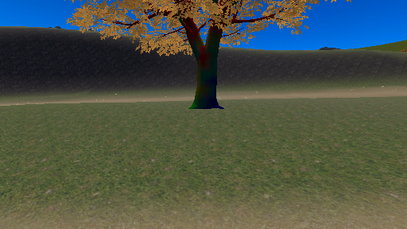
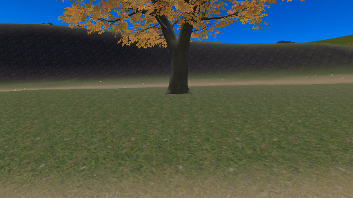
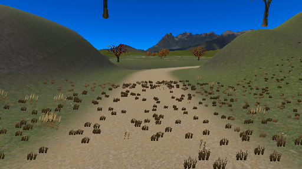
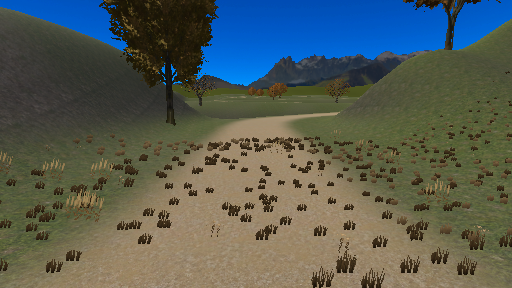

# DES-ENV-002 コース拡張の計測と制作

2026-09-27。本番採用済み。普段の作業対象は `Assets/Scenes/VRCDefaultWorldScene.unity`。[本番切替と整理](production.md)。以下の旧シーン名・中間値は制作時点の履歴。

ユーザーの着手承認後の記録。[採用した周回構成](index.html)を、元本シーンを保全した KH_RiverLoopCourse へ実装した。約2.41kmの地形・NavMesh・436点の経路・目的地メニュー・景観のLOD/遮蔽を構築し、川岸・樹皮・植生の接地・外周と斜面のつながりを調整した。現行地形で犬6匹の正逆一周をローカル検査済み（[正方向](verification-records.md#full-course-walk-lap-forward-final) / [逆方向](verification-records.md#full-course-walk-lap-reverse-final)）。**人の実歩行時間、実通信、VR/端末表示、16人・長時間性能は未確認で、完成・公開可能とはしていない。** 以下は段階ごとの制作履歴で、初期の代表区間と現行の全周シーンの結果を分けて記録する。

## 見た目の追加指定：自然な川岸へ（v2）

ユーザーの「もう少し自然な見た目にしたい」に合わせ、川幅と左右の岸に変化を付け、浅瀬・砂利混じりの地表・16群48個の小石を加えた。石は1メッシュ・1材質・1 Colliderで、犬の歩行対象から除外。橋は形状と床Colliderを保ち、128²の共有木目と板ごとの微妙な色差を追加した。水面は不透明・反射なしを維持し、流れ模様を小さく弱め、橋下の固定遮蔽を頂点色に持たせた。

現在は代表区間の修正版であり、ユーザーの見た目採用・実機合格ではない。この代表区間時点では遠景と全周の接続は未仕上げ。全周化・描画距離・夜のEditor確認は後段に記録。端末の視認性は残る。以前の均一な川岸を完成基準にしない。変更前の画像は [v1](assets/river-representative-v1.png)、旧測定の全記録は [measurements-v1.json](verification-records.md#measurements-v1) に保存した。下記の旧測定表はv1の履歴として扱う。

## 全周の地形へ展開（地形段階、制作中）

検証用シーン Assets/Scenes/KH_RiverLoopCourse.unity を元本からコピーし、20枚の120×180m Terrain、24区間の水面、小橋2基を構築した。旧TerrainDataも専用コピーに差し替え、旧道と広場を保護し、北の出口と東の帰着口だけを接続する。全周を完成済みとは扱わず、地形に続くNavMesh・経路・メニューの検査は下記を参照。この地形段階より後の植生・LODは下記に記録。実機性能は残る。

初回の足場検査で、帰着線の南側が古民家の外壁に重なる箇所を検出。塀を移動せず、道を北へ回して既存の道へ合流させた。元の案の約1.82kmでは歩行設定2m/sで約15分になるため、林道の折り返しと帰りの小道を延長し、曲がり角を丸めた約2.4kmを制作基準にする。20分は設定速度からの設計値で、犬連れの実歩行は未確認。

- 原本：[KH_CourseGroundEditor.cs](../../../Assets/KominkaHillside/Scripts/Editor/KH_CourseGroundEditor.cs)。13は初回コピー専用、15は所有Terrain/遠景余白だけの更新。手調整を無条件に再生成しない。
- 別検査：[KH_CourseGroundVerify.cs](../../../Assets/KominkaHillside/Scripts/Editor/KH_CourseGroundVerify.cs)。14で保存済み地形、旧道/広場、足場、外周接合、材質、コピー公開先IDを検査する。
- 外周余白はTerrain端と同じ4,608点で接続し、38m先から粗いメッシュへ移る。元の粗い端が川口を塞ぐ問題を独立レビューで発見・修正した。
- 既存の遠景リングはコピー内のみ移動/拡大。旧サイズ向けの内側地面・板木2 Rendererは新地形と交差するため非表示にし、外の山・林を残す。購入メッシュ/材質の原本は変更していない。
- カメラ：コピーのDescriptor Reference CameraのFarを1000→2200mへ拡張、Nearは既存の0.3mを保持。新しい散歩範囲から外周の山まで含めるため。これは参照Cameraの値であり、VRChat実機の有効Near/Farの観測ではない。
- 素材：川・橋・シェーダーは代表区間と共有。地表4層と遠景は既存の同一用途の参照。新しい外部素材・画像生成・公開は行っていない。

保存シーンを開き直し、別メニューの検査でGROUND_STRUCTURE_OK・エラー0を確認した。[検査JSON](verification-records.md#full-course-ground)：足場14,499点、旧道/広場534点、外周接合4,608点。20枚の地形間の最大段差0、旧道/広場の最大高さ差1.53mm（高さ量子化）、外周接合最大4.53mm（3mmの埋め込みを含む）、道の最大勾配16.41度。中心線の合計2,406.89mで、設定2m/sなら20.06分。旧道部分は地形生成曲線を用いるため、初期調査の経路グラフ113.8808mを足す計算と約1.32m異なる。犬連れの歩行時間・NavMeshの完成経路ではない。

| 対象 | 圧縮ダウンロード | 非圧縮 | 拡張前との差（圧縮） |
|---|---:|---:|---:|
| Android | 45.06 MiB (47,244,780 bytes) | 119.73 MiB | +2.30 MiB |
| iOS | 44.11 MiB (46,247,543 bytes) | 115.34 MiB | +2.33 MiB |

[全周計測JSON](verification-records.md#full-course-measurements)。主シーン・旧Terrain・QualitySettingsのSHA256不変を確認。Android/iOSとも代理バンドルであり、16人時の描画性能と使用メモリは未検証。

独立レビュー担当 /root/proposal_review は旧道保護、32m以内の道路索引、丸め後171点の自己交差なし、川との横断が2橋のみであることを読み取り/座標計算で確認。主担当 /root は保存後の足場・勾配・継ぎ目を実行検査した。

画像：[全景](assets/full-course-ground-overview.png) / [下流の橋](assets/full-course-lower-bridge.png)。いずれも全周地形のEditor Scene View。植生、川岸の細部、遠景との見た目の接続は制作中。この画像は小石の全周配置前。下記の景観段階で石・草・木を追加した。HTMLは最新の丸め済み中心線を使い、初期案は[旧座標JSON](verification-records.md#proposal-data-v1)へ保存した。

## 全周NavMeshの接続

[KH_CourseNavigationEditor.cs](../../../Assets/KominkaHillside/Scripts/Editor/KH_CourseNavigationEditor.cs) の19で、全周専用NavMeshを生成。コピー側の旧Surfaceだけを無効化し、旧NavMesh資産は保持する。20が別検査。対象600×720m、Physics Collider・layers 0/11、voxel 0.15m、tile 256。川床を240個の明示center=zeroのVolumeで除外し、橋床は水面+0.9mに残す。地形・Collider・犬は無効化しない。

保存後に開き直し、[検査JSON](verification-records.md#full-course-navigation)でNAV_GEOMETRY_OK・エラー0。道沿い562点・561区間がつながり、橋2基×3列の6経路が橋面を横断。河床117点を除外。NavMeshは8,467頂点・3,743三角形。最大スナップ距離0.205m、局所経路の余分な迂回0m。元のNavMeshのSHA256は作業前と一致。これは静的形状の通行検査で、犬・リード・正逆周回・Owner交代の合格ではない。この測定時点は経路グラフ追加前。次節で旧17点を保持した436点の閉路へ接続した。

独立レビュー /root/proposal_review：元資産の保全、川床と橋の離隔、検査範囲は問題なし。ベイク例外時の後片付けの指摘を反映し、旧Surfaceを戻して新Rootを削除、復元シーンを保存後にだけ新規資産を削除する。保存自体が失敗する場合は参照切れ防止のため資産を保持して報告。同担当の限定再確認で解消。正常系は再読込検査済み、故障注入による復旧確認は未実施。

上記45.06 / 44.11 MiBは全周NavMesh追加前の容量。今後の犬経路・景観追加も含めて再計測する。[地形全景](assets/full-course-ground-overview.png)：Scene View 890×688、pivot(300,20,360)、Euler(70,0,0)、size390。[下流の橋](assets/full-course-lower-bridge.png)：pivot(417.5,6.5,190)、Euler(10,245,0)、size10。昼・Editorの確認であり、端末の見た目合格ではない。

## 犬の経路と手元メニューの接続（実移動は未検証）

旧17地点と到着半径を維持し、全周を436地点・436リンクの閉路として保存した。[経路の検査](verification-records.md#full-course-route)はROUTE_DATA_OK・エラー0。正逆17,440ステップ、最短経路1,744組、近傍1,544点、途中復帰1,664ケース、入口候補11,999件を検査。NavMesh経路を合算した2,408.59mは、地形中心線2,406.89mと測定対象が異なる。犬の歩行時間ではない。

- 閉路は累積距離から最短帰還を計算し、全地点の二乗表を持たない。32mの空間索引で近傍探索を絞り、検査地点ではリンク候補最大43・入口候補最大41。これは検索件数であり端末CPU負荷の実測ではない。
- 山道から／川からの周回は方向を固定し、門を通過して次周へ進む。目的地への移動は短い側を選ぶ。橋付近の寄り道を抑え、リードに戻った後の再接続では進行方向を保つ。Owner交代・退出は既存の制御へ委ね、新しい同期変数は追加していない。
- 元本の17点について全289組の旧経路表との一致と近傍706点を検査した（[元本の記録](original-route.json)）。シーンファイルを保持することと、共有スクリプトの挙動確認は区別する。

手元の「さんぽ」は既存の犬6行に、広場／古民家側の入口／山道から周回／川から周回／奥の広場／川辺の6行を接続。自分の接続犬だけへ既存の要求経路で伝え、選択・混在・処理待ち・結果不明を表示する。新しい現地看板・リード拠点は追加していない。既存本シーンは拡張配列が空で、従来の2目的地に戻る。

[メニューの検査](verification-records.md#full-course-menu)は保存再読込後にCOURSE_MENU_DATA_OK・エラー0。12行、6ボタン、13言語×7文言、保存されたUdon配列とクリック先を照合。日本語・英語のタイトル／状態／操作／フッター64件が通常文字サイズで枠内（縮小なし）。その他11言語のクライアントフォント表示、VR・タッチのスクロールと実通信の応答は未検証。

追加翻訳の正本は[CourseUITranslations.json](../../../Assets/KominkaHillside/Data/Environment/Course/CourseUITranslations.json)。基本翻訳表を変更せず、同じ言語順の任意拡張として別シーンへ配線した。既存フォントへ「周・川・奥・辺」の4字を追記（817→821 glyphs、2048²、48pt、padding6、元のStatic設定を保持）。既存ツールがStaticへ戻す際にランタイムの元TTF参照を外した。編集用参照とGUIDは保持しており、元フォントを削除していない。[別検査](verification-records.md#course-font-verification)で旧817グリフの記録・文字対応・余白込み2,294,495ピクセルがgit HEADと一致した。元本も使う共有フォントの変更であり、コース専用の容量削減とは扱わない。再生成時は[KH_CourseMenuEditor](../../../Assets/KominkaHillside/Scripts/Editor/KH_CourseMenuEditor.cs)の27でカタログの文字を補完する。25は初回追加のみ、26は検査。共通のメニュー再構築は追加行を含めて再検査するまでこのコピーへ適用しない。

C#／Udonコンパイルはエラー0、Imported側82スクリプトのout/ref規約検査も0。独立レビュー /root/proposal_review は周回の復帰・旧経路互換・共有権限・メニューの状態／翻訳を確認。Return中に古い地点へ戻る指摘と、複数シーンを開いた際の誤操作の指摘を修正し、限定再確認で解消。主担当はAdditive拒否と元本を保存しない復元を実行して確認した。実機の犬1/3/6匹、16人、途中参加・Owner交代、Quest 3／iPhone 15 Proの合格はまだない。

## 経路・メニュー接続後の容量

| 対象 | 圧縮ダウンロード | 非圧縮 |
|---|---:|---:|
| Android | 41.85 MiB (43,882,121 bytes) | 112.80 MiB |
| iOS | 41.03 MiB (43,028,246 bytes) | 109.21 MiB |

全周NavMesh・436地点の経路・6目的地メニューを含む別シーンの代理容量。字形追加時に共有フォントのランタイムTTF参照が外れたため、前回より容量が減った。経路だけの削減量ではなく、共有フォント変更を含む値。基本／追加文言の字形と旧817グリフの保全は別検査済み。16人時の性能・使用メモリ・Quest 3/iPhone 15 Proの見た目は未検証。 [測定JSON](verification-records.md#full-course-route-measurements)。元本シーン・旧Terrain・QualitySettingsのSHA256は作業前と一致。モバイル上限検査71枚・不足0。

## 全周の景観と距離に応じた表示（2026-09-27）

### 制作前の方針

- 方針：core-concept §3。「もう少し自然な川岸」、犬が主役、簡素さと軽量化を優先。NATURE／背景／固定物。
- 対象：川際の少量の丸石と草の群れ、林道の疎らな樹木。一般的な形の石・草はコード生成、外部画像や特定作品の模写なし。既存LMArtのBroadleafTreeB01と対応するBoard_TreeB01、既存の秋材質を同じワールド内で参照し、購入元は変更しない。出所は上記素材記録。
- 選定：B01は24,291三角形・2 Renderer・LODなし。A01は12,980だが既存の秋葉と形を揃えるため今回はB01を近景へ限定。遠くは対応する十字板2枚（4三角形）へ切替。全景を近景モデルで埋めない。
- 初期予算：追加木は約20〜30本、近景は同時に見える数を測る。石は4種の小群を共有し、草は30m区画へまとめる。材質5個・既存テクスチャを参照。これは制作時の目安で、性能の合格値ではない。
- 表示：UnityのカメラごとのLODとfrustum cullingを用い、LOD間／消える境界はdither crossfade。遠景の木は板を残し、小石と草は遠距離で描画を省く。GameObject・Collider・Terrain・NavMesh・犬を無効化しない。プレイヤー位置だけで判定しないため、写真カメラを置き去りにする方式にはしない。
- 検証：保存後の構造、道との離隔、NavMesh再生成後の全周と橋、Scene Viewの橋／川辺／奥広場、Editorの同一視点ON/OFF計測。VR両眼・写真・端末でのLOD切替、夜、16人時の性能は未検証。丘に完全に隠れた区画の追加遮蔽処理はこの段階のLODと区別する。

### 配置・保存後の確認

木15本、石61群（183個）、草24区画（2,800枚のblade）を追加した。生成元は [Build](../../../Assets/KominkaHillside/Scripts/Editor/KH_CourseSceneryEditor.Build.cs)、独立した保存状態の検査は [Verify](../../../Assets/KominkaHillside/Scripts/Editor/KH_CourseSceneryEditor.Verify.cs)。29は初回追加のみ、30は専用NavMeshの更新、32は検査。購入元への書き込みなし。木の候補が斜面・川・道に近い場合は除外し、初期上限の20〜30本より少ない15本になった。

[構造検査](verification-records.md#full-course-scenery)はエラー0。共有材質5、共有メッシュ31、LODGroup100、Renderer145、Collider76。全近景を足した375,217三角形は常時描画量ではない。木は1本24,291→遠景4三角形へ切替（15本の遠景合計60）。LODは画面占有率で判定し、木の切替0.18・消失0.005、石0.025・草区画0.35。距離の固定値へ読み替えない。透明ブレンド・反射・風・追加Udonは使わず、葉はcutout・両面、草は頂点色、石は頂点色と標準白テクスチャ。石と草の材質に外部画像は要らない。

ColliderはLODから独立し、石をNot Walkableに指定してNavMeshを再生成した。保存再読込後の [Nav検査](verification-records.md#full-course-navigation-scenery)は562点・6橋経路・117河床点でエラー0（3,892三角形）。[道の検査](verification-records.md#full-course-route-scenery)と[地形の検査](verification-records.md#full-course-ground-scenery)も通過。草の根元は各blade位置で地面を再サンプルし、最大差0.012mm。木の近景と遠景は上下端の最大差0.004mm。これは形状・データの検査で、実際の犬・リードの通行合格ではない。

昼のEditor画像：[下流の橋](assets/full-course-scenery-bridge.png) / [川辺](assets/full-course-scenery-river.png) / [奥広場](assets/full-course-scenery-plaza.png)。890×688、橋pivot(417.5,6.5,190)・Euler(10,245,0)・size10、川辺pivot(505,11.82,285)・Euler(9,310,0)・size0.01、奥広場pivot(215,41.82,615)・Euler(10,200,0)・size0.01。川辺と奥広場はScene ViewのFarを参照Cameraと同じ2200mへ一時設定した。1000mでは遠景が途中で切れていたが、2200mでは同じ場所で解消した。撮影後は元の視点・自動clipへ復元。端末の有効Farと見た目は別確認が必要。

独立レビュー担当 /root/proposal_review は生成物の所有範囲、購入元保全、Collider維持、シェーダーの両眼／LODマクロを確認。Nav更新の復旧保存が失敗すると再登録を飛ばすP2を指摘し、メモリの参照とAddDataを保存前のfinallyで復旧するよう修正。限定再確認で解消した。故障注入は未実施。C#コンパイルエラー0。

**この景観段階で残った条件：** 丘の陰の遮蔽は後段で設定・比較計測。残るのはVR／写真カメラでの切替、Quest 3／iPhone 15 Proの実表示と16人・犬連れ性能。この節のLODだけの測定と、後段の遮蔽比較は区別する。

### 景観追加後の容量

| 対象 | 圧縮ダウンロード | 非圧縮 | 景観追加前との差（圧縮） |
|---|---:|---:|---:|
| Android | 42.80 MiB (44,878,960 bytes) | 114.87 MiB | +0.95 MiB |
| iOS | 41.97 MiB (44,007,872 bytes) | 111.28 MiB | +0.93 MiB |

木15本・石61群・草24区画、LOD用の材質と更新NavMeshを含む保存シーンの代理バンドル。遠景木の秋色アトラス Tex_BroadNature02_Autumn はモバイルのみ2048→1024上限・圧縮ありへ設定し、PCと元画像は維持。共有秋色画像の変更で、上限の正本はKD_BuildSizeEditorの個別行と追跡対象.meta。前段と同じ圧縮・対象で比較し、景観追加分を記録した。非圧縮サイズは端末メモリの実測ではない。Quest 3／iPhone 15 Proの実表示、犬連れと16人の性能は未検証。 [計測JSON](verification-records.md#full-course-scenery-measurements)。

### 全周の追加景観の描画寄与

[測定記録](verification-records.md#full-course-scenery-benchmark)。UTC run 20260926-180850、3地点×ON2回/OFF2回を完走。切り替えたのは追加の木・石・草のRendererだけで、地形・水面・橋・犬・Colliderは維持。ClientSimの実カメラFarは2200m。1920×1080・Desktop・既存6匹の通常状態で、リード散歩・16人アバターではない。

| 視点 | ON / OFF draw calls | 差 | ON / OFF 三角形（平均概数） |
|---|---:|---:|---:|
| course-lower-bridge | 302 / 290 | 12 | 381,805 / 380,415 |
| course-river-rest | 318 / 300 | 18 | 385,962 / 383,820 |
| course-upper-plaza | 293 / 289 | 4 | 426,528 / 377,919 |

FPS/vSync/runInBackgroundは復元。Play終了後にシーンがdirtyになったため、保存ファイルのSHA256不変を確認して、保存せず同じコピーを開き直した。別の構造検査で145 Rendererの描画状態、Collider、地形の復元を確認した。report.restored=trueだけを描画復元の証拠にしていない。

奥広場では近景の木を含む増分48,609三角形、橋／川辺では主に簡略木・石・草の増分約1,390／2,142三角形。全近景375,217三角形を常時描いているわけではないが、最も重い視点や全コースの上限を測った結果でもない。Frame間隔はEditorの仕事を含むため、QuestやiPhoneのFPSへ換算しない。

## 夜の川・橋・植生のEditor描画確認

既存のKH_NightModeは光源を切り替える方式ではなく、queue4999の全画面乗算と空の露出／Tintを使う。[既存設計](../2026-09-21-sky-and-night-mode.md)を読み直し、queue2000の川と、橋・草・木もその対象に入ると確認した。川のshaderへ別の夜減光を追加すると二重になるので、runtimeや材質は変更していない。

[KH_CourseNightEditor](../../../Assets/KominkaHillside/Scripts/Editor/KH_CourseNightEditor.cs)の33で、既存夜モードの定数を使う複製材質・一時Cameraから昼／夜の3組をオフスクリーン描画。[検査結果](verification-records.md#full-course-night)はNIGHT_EDITOR_RENDER_OK・エラー0。水面24・追加景観145の描画順とUdonの参照を照合し、川・橋・地面が一緒に暗くなることを画像で確認した。下半分の平均輝度（PNG RGBの加重平均）は昼0.467〜0.538→夜0.101〜0.122。これは表示データ上の比較で、実機の明るさの指標ではない。

[橋の昼](assets/course-night-bridge-day.png) / [橋の夜](assets/course-night-bridge-night.png) / [川辺の夜](assets/course-night-river-night.png)。890×688、FOV60、参照CameraのNear0.3／Far2200を使用。Night最大値のため暗いが、道の形・橋の手すり・水面の境界は画像上で識別できる。端末での視認性合格ではない。元Skybox／Overlay材質、参照Camera、RenderSettingsを変更せず、一時資源はfinallyで破棄。終了後scene cleanを確認した。共有shaderにも夜専用処理を足していないため、容量と昼の描画寄与の前回計測は変更していない。

**未確認：** Udonの実際のフェードと保存設定、VR両眼、VRChatのミラー／写真カメラ、Quest 3／iPhone 15 Proで川際の低い目線から歩ける明るさ。Editor確認を実機の見た目合格に読み替えない。

## 地形による遮蔽と比較計測（2026-09-27）

Unity標準のOcclusion Cullingを全周コピーへ設定し、20枚の地形だけを遮蔽物とした。木の葉や動く扉は遮蔽物にしない。旧古民家PrefabのOccluderフラグはコピー内のinstanceだけで解除し、購入元は変更していない。地形ごとに明示View Volumeを設け、夜の全画面OverlayとSky Holderは遮蔽対象から除外した。Rendererの描画判断だけを変え、Terrain・Collider・NavMesh・犬・GameObjectの有効状態を切り替えない。BOOTHの区画表示商品は追加していない。

ベイク生成は一度実施。ネイティブ終了直後のimport待ちを完了と誤認しないよう監視を修正し、生成と保存を分離した。保存後の再読込でOCCLUSION_DATA_OK・エラー0、20地形・20View Volume、所有PVSデータ1,323,616 bytesを確認。これは端末のメモリ増分ではない。生成資産は Assets/Scenes/KH_RiverLoopCourse/OcclusionCullingData.asset。

[比較の原記録](verification-records.md#full-course-occlusion)。Editorの単眼384×216・FOV60・Near0.3/Far2200で、経路10点おきの両方向88視点、代表3視点、橋2基の低/高目線4視点、計95視点をOFF/ON/OFF比較。RGB差が2/255を超える画素は0、OFF同士の変化も0。低解像度の疎な標本であり、全視点・VR両眼・写真・ミラーでの保証ではない。[橋ON](assets/occlusion-bridge-on.png) / [橋OFF](assets/occlusion-bridge-off.png)。

同じClientSimハーネスで実カメラのuseOcclusionCullingだけをON2回/OFF2回に切替。3地点・12標本群を完走。地形・景観・犬・Colliderは維持。Desktop 1920×1080、i7-14700KF / RTX4070Ti SUPER、通常状態の6匹・ローカル1人。リード散歩・16人ではない。

| 視点 | 遮蔽ON / OFF draw calls | 遮蔽ON / OFF 三角形（平均概数） |
|---|---:|---:|
| course-lower-bridge | 304 / 303 | 381,802 / 381,804 |
| course-river-rest | 131 / 319 | 204,623 / 385,962 |
| course-upper-plaza | 79 / 294 | 217,327 / 426,528 |

これは固定視点の描画量比較。UnityStatsはEditor Viewを含む可能性があり、端末FPSや遮蔽のCPU時間へ読み替えない。上限FPS・vSync・runInBackgroundと実カメラ設定を復元。Playでdirtyになったコピーは保存ファイルのハッシュ不変を確認し、保存せず開き直して、別の景観/遮蔽検査を通した。元本シーン・旧Terrain・QualitySettingsのハッシュも不変。

独立レビュー /root/proposal_review：ベイクの監視/保存分離、遅延import、画像比較の対照、計測後の復元を読み取り確認。出力失敗でベイク監視が解除されるP2を修正し、限定再確認で解消。実機の画像・負荷合格は判定していない。次は犬の実際の周回と、VR/写真/端末の表示・歩行時間・16人性能を確認する。

### 遠景の不要スクリプト除去・周回復帰修正後の容量

| 対象 | 圧縮ダウンロード | 非圧縮 |
|---|---:|---:|
| Android | 43.22 MiB (45316353 bytes) | 116.15 MiB |
| iOS | 42.41 MiB (44471305 bytes) | 112.55 MiB |

全周コピーの保存シーンを同条件で再計測した。非圧縮は実機メモリではなく、SDKアップロード・16人性能・Quest 3/iPhone 15 Proの表示は別途確認する。[今回の原記録](verification-records.md#full-course-walk-measurements)。

### 遮蔽データ追加直後の容量（履歴）

| 対象 | 圧縮ダウンロード | 非圧縮 | 遮蔽追加前との差（圧縮） |
|---|---:|---:|---:|
| Android | 43.23 MiB (45,326,664 bytes) | 116.15 MiB | +437.2 KiB |
| iOS | 42.41 MiB (44,471,721 bytes) | 112.55 MiB | +453.0 KiB |

地形の遮蔽フラグ・20 View Volumeと所有PVSデータを含む保存シーンの同条件代理計測。夜の確認は材質の複製によるEditor描画だけで、ランタイム資産は追加していない。非圧縮サイズは実機の使用メモリではない。SDKアップロード・Quest 3/iPhone 15 Proの実表示・16人性能は未確認。 [計測JSON](verification-records.md#full-course-occlusion-measurements)。

## 拡張前の計測（履歴）

- 容量の正本：[最新ビルドサイズ](../2026-09-24-build-size-audit.md)。Android 42.75 / iOS 41.78 MiB。
- Editor計測：Unity 2022.3.22f1、i7-14700KF、RTX 4070 Ti SUPER、ClientSim Desktop 1920×1080、1人・既存犬6匹の通常状態。上限FPS/vSyncを一時解除し、終了時に復元した。
- ローカル記録：`Logs/kh-course-benchmark/20260926-160135/report.json` (UTC)。各地点3秒待ち+6秒採取を2回、開始時15秒待ち。自動終了と復元、通常完走の再試行を確認。途中リロード・出力故障の復旧経路はコードレビュー済みだが実行試験は未完。

| 視点 | 観測フレーム間隔の平均（2回） | UnityStats draw calls | trianglesの平均 |
|---|---|---:|---:|
| 入口から上り方向 | 8.39 / 8.49 ms | 194 | 約349,248 |
| 見晴らしから古民家方向 | 8.24 / 8.14 ms | 223 | 約252,117 |
| 広場から奥 | 6.67 / 7.03 ms | 71 | 約72,161 |

Editor.updateで観測した最新ゲームフレームであり、全フレームのCPU/GPU計測ではない。UnityStatsにEditor描画が含まれる可能性があり、端末の合格FPSや余力へ換算しない。6匹リード散歩・16人アバター負荷は測っていない。入口/展望側の既存景観も描画量を持つため、拡張部分だけで予算を判断しない。

プレイヤーの歩行設定2m/s・走行4m/sを確認。提案の1,807.76mは2m/s固定で約15.1分。犬連れの実歩行平均速度は未測定で、約20分を満たす最終距離は未確定。

## 代表区間v1の描画寄与（変更前の履歴）

[測定JSON](verification-records.md#measurements)。同一の代表シーン・同一視点で、追加景観をON2回/OFF2回ずつ比較（UTC run `20260926-163101`）。OFFにしたのは代表区間のRendererとTerrainの描画だけ。GameObject、Collider、NavMesh、犬は動かしたまま。3地点・12標本を完走し、FPS/vSync設定を復元した。停止後の構造Verifyで全11 MeshRendererのforceRenderingOff=false、Terrain描画ONを確認した。report.restoredはFPS/vSync/runInBackgroundだけの判定であり、描画設定の検証はこの別検査による。

| 視点 | 追加景観ON / OFFのdraw calls | 差 | ON / OFFの三角形（平均概数） |
|---|---|---:|---|
| 橋付近 | 270 / 256 | 14 | 377,440 / 341,200 |
| 上流側の岸 | 242 / 225 | 17 | 346,128 / 279,258 |
| 既存見晴らしから古民家 | 246 / 246 | 0 | 253,797 / 253,798 |

同じ計測内の描画差を示す。過去の別シーン/Scene View条件の絶対コール数とは直接差し引かない。ON/OFF間で観測フレーム時間の範囲は重なり、PCでの速度改善を断定できない。OFF時もメモリやダウンロード容量は減らない。恒久的な景観カリングの実装/検証はこれからで、この計測中のOFF操作を完成機能としない。

## 川の代表区間・制作票

### 目的・用途と見た目

犬と歩く背景となる、控えめな川岸と小橋。方針は [core-concept](../../core-concept.md)（2026-09-27）。現在の簡素な景観に合わせ、透過・反射の豪華さより犬と道の見やすさを優先。状態：制作中、採用検証前。

### 対象と予算

PC / Quest 3単体 / iPhone 15 Pro。水面は不透明1描画パス・1枚の128²流れマスクをBASELINEとする。6区間で材質共有。橋は1材質・480三角形。v2は水面1,440三角形、石1,824三角形。樹木2本は既存素材を参照し、追加画像を持たない。水面は岸や橋から0〜数m、橋は足元〜数十m。画面内同時数・全周での描画/容量予算は実測待ち。

### 形状・寸法と作り方

代表区間120×180m、原点(360,0,120)。地形のheightmap257 / alphamap256。川幅は区間ごとに変え、水面と左右非対称の岸の交差で輪郭を出す。水面30m×6分割、小橋10×3.5m。橋の床/両側にBoxCollider、TerrainColliderは常時有効。水面にColliderは付けない。TerrainのLODはUnityの機構を使用。樹木LOD・境界を隠す景観・既存遠景との接続は未完成。

### 接続点・可動・適合

水の模様だけ時間で動く。リグなし。コピーのスポーンを川岸へ移した。代表区間には専用NavMeshを追加し、橋の横断と川床の除外を静的検査した。既存の犬6匹と既存ナビゲーションは元の場所にあり、代表区間への犬の誘導・実際のリード散歩は未検証。全周コピーでは両岸・橋のNavMeshを接続済み。既存ルート17点を保持した犬の経路グラフ統合はこれから行う。

### 材質・UV・テクスチャ

`KominkaHillside/River Lite`：不透明・ZWrite・片面・fog・VR stereo macros、GrabPass/depth/反射カメラなし、1回のテクスチャ参照。水色は頂点色で岸から中心へ補間。UVの上流方向にサンプルを進め、模様を下流へ流す。unlitなので実光源への応答はない。夜モード/VR両眼/端末表示は未確認。マスクはlinear、repeat、mipmap、Read/Write無効、Android/iOS ASTC 6×6。v2の橋と石は Scenery Lite（頂点で環境光+主平行光、fog、VR stereo、追加光・影受信なし）。橋は影を落とすパスを持ち、石は影OFF。木目は128²・sRGB・repeat・mipmap・モバイルASTC 6×6。地表4レイヤーと樹木の秋材質は既存参照。

### ファイルと引き渡し

- 生成原本：[KH_RiverRepresentativeEditor.cs](../../../Assets/KominkaHillside/Scripts/Editor/KH_RiverRepresentativeEditor.cs)。初回のみコピーを生成し、既存コピー/生成フォルダがある場合は上書きを拒否する。
- シェーダー：[KH_RiverLite.shader](../../../Assets/KominkaHillside/Shaders/KH_RiverLite.shader)。生成資産は `Assets/KominkaHillside/Data/Environment/River/`。
- 検証用シーン：`Assets/Scenes/KH_RiverRepresentative.unity`。本シーンは `VRCDefaultWorldScene.unity` のまま。コピーの公開先IDを空にし、本番ワールドへのアップロード先を引き継がない。アップロード自体は行っていない。
- メニュー：`Tools/KominkaHillside/Course/`。生成とVerifyを別操作にする。Surface Assetsの更新は地表塗装/水面マスクだけ。v2は12 - Naturalize River Representativeで生成済みの代表資産を更新し、10 - Rebake River Navigationと別Verifyを行う。手調整済み資産に無条件で再適用しない。
- [Editor計測](../../../Assets/KominkaHillside/Scripts/Editor/Testing/KH_CourseBenchmarkEditor.cs) / [代表シーンの容量計測](../../../Assets/KominkaHillside/Scripts/Editor/Testing/KH_CourseBundleEditor.cs)。計測はアップロードしない。
- [代表区間のNavMeshと足場検査](../../../Assets/KominkaHillside/Scripts/Editor/KH_RiverNavigationEditor.cs)。既存のNavMeshを共有更新せず、生成先を川専用データに限定する。

### 参照元と権利

橋形状・水面メッシュ・小石・木目・マスク・シェーダーは本タスクの数式/コード生成。外部画像やモデルの模写/入力なし。生成履歴は上記Editor原本。既存TerrainLayer、LMArt樹木と秋材質は [既存移植記録](../../development/imports/kominka-autumn-assets.md)の同一プロジェクト内参照。購入元データは変更していない。ここで権利確認を新たに完了した意味にはしない。BOOTHの区画可視性アセットは未購入/未導入。

### 仮決め・未確定

代表区間の座標・水位・川幅は制作検証用。提案全体の確定寸法ではない。この代表区間単体では20分の距離・全周接合を扱わない。全周コピーの地形/NavMeshは上記の別工程で構築済み。周回意図とメニューは下記の別工程で接続。この代表区間時点の未完項目（犬の実移動、景観カリング、樹木LOD、遠景の仕上げ）は全周工程の各節へ引き継いだ。実歩行時間は未確認。既存遠景の外側に検証区間を置いているため背景に端/継ぎ目が見える。[Editorでの川と橋](assets/river-representative-editor.png)は完成景観の合格画像として扱わない。

### v1の確認結果（変更前の履歴）

C#コンパイル成功、砂道/全材質/全submeshを含む構造Verifyでエラー0。水面720三角形+橋480三角形+樹木48,582三角形（2本）、Terrainを除く合計49,782三角形・MeshRenderer11個。全周化では樹木をそのまま面積分複製しない。

Editor画像で地表塗装の消失を発見：TransientなTerrainDataの塗装後にCreateAssetすると塗装が失われていた。保存順序を修正し、砂道の実データを別Verifyで確認した。橋と水面の近景をEditorで確認。背景の端/遠景の交差は未仕上げ。

NavMesh/足場の別検査：橋の3列×101点で足場の穴0、隣接0.25mサンプル間の最大段差0.0166m。3列とも経路25m・橋面横断・PathComplete。河床16地点がNavMesh対象外。最初はNavigation 1.1.5のVolume.center既定値(0,1,0)で橋まで除外していたため、zeroへ修正した。修正後の検査で残った5件は検査側の整数除算で岸を測っていた誤判定。実際の川中心を独立evalで確認し、浮動小数点除算へ直して再検査した。犬の移動・リード・実機での通行合格ではない。

独立レビュー担当 `/root/proposal_review`：代表区間/シェーダーと計測・NavMeshのコードを読み取り確認。材質/三角形の全スロット集計へ改善。Rebake失敗時に旧NavMesh参照が残る場合を見逃す指摘を修正（旧参照/永続データなら置換前に拒否）。同担当の限定再確認で解消。実行検査は主担当 `/root` が担当。

Android GLES3 / iOS Metal向け代理バンドルでRiver Liteのコンパイルを確認。端末実表示・VR両眼・夜は未確認。NavMesh追加後の最終再計測はAndroid 43.59 MiB（45,707,586 bytes、追加0.84 MiB）、iOS 42.76 MiB（44,842,079 bytes、追加0.99 MiB）。容量の正本は [ビルドサイズ実測](../2026-09-24-build-size-audit.md)、原データは [測定JSON](verification-records.md#measurements)。全周の容量予測・描画性能の合格にしない。比較用の途中値（NavMesh追加前）はAndroid 45,687,055 bytes / iOS 44,840,163 bytesだった。

### v2の確認結果

C#コンパイルと構造検査エラー0。Terrainを除き合計52,326三角形・12 MeshRenderer（v1から+2,544三角形・+1 Renderer）。橋3列×101点の足場検査で穴0、最大段差0.0436m。3経路とも約25mで橋を横断し、河床16地点は歩行対象外。実際の犬・リード通行は未検証。修正版の容量はAndroid 43.65 MiB / iOS 42.84 MiB。v1からの増分は各61.89 / 80.89 KiB。非圧縮は111.81 / 108.22 MiBで、端末メモリの実測ではない。描画寄与はUTC run 20260926-165748 でON2回/OFF2回×3地点を完走、FPS/vSync等を復元。描画状態は停止後の別Verifyでも確認した。

| 視点 | ON / OFF draw calls | 差 | ON / OFF 三角形（平均概数） |
|---|---|---:|---|
| river-bridge | 271.0 / 257.0 | 14.0 | 381,684 / 341,197 |
| river-upstream-bank | 245.0 / 225.0 | 20.0 | 344,003 / 279,260 |
| viewpoint-kominka | 243.0 / 243.0 | 0.0 | 253,796 / 253,796 |

Editorの同一視点比較であり、実機のFPSや16人参加の合格ではない。フレーム時間にはEditor処理や既存犬の動作が含まれる。v1の別計測の絶対値とは直接差し引かない。

代表画像は [橋付近](assets/river-representative-editor.png) と [川沿い](assets/river-natural-upstream.png)。KH_RiverRepresentative、昼、Editor Scene View 890×688、視点pivot(416,4.5,190)/Euler(10,245,0)/size7、川沿いpivot(423,5,220)/Euler(13,18,0)/size12。岸の非対称化と小石・木目を確認。遠景の端、岸と植生の馴染ませ、夜・VR・端末での見た目は未検証/未仕上げ。HTML内の画像・リンク・スクリプト整合は静的検査済み。今回のブラウザ再描画QAはローカルChromeのGPUプロセス起動失敗により未実施。

独立レビュー担当 /root/proposal_review は所有資産/GUID保全、法線、Nav除外、軽量shaderを読み取り確認。橋の影が消える指摘に対しShadowCasterパスを追加した。

### 変更履歴

- 2026-09-27：追加前の容量/Editor負荷測定、川用shader・コピーシーンの代表区間・検証メニューを追加。確認端末をQuest 3 / iPhone 15 Proと記録。本番全周への統合はまだ行っていない。

## 実Udonでの歩行検査台と最初の橋渡り（2026-09-27）

終了・80秒/ケースの制限・全体期限・手動停止を持つ [KH_CourseWalkHarnessEditor](../../../Assets/KominkaHillside/Scripts/Editor/Testing/KH_CourseWalkHarnessEditor.cs) を追加。40は下流橋の1匹/正方向、42は2橋×2方向×1/3/6匹と門の境界×2方向×1/3/6匹、計18ケース。41で停止。Playでしか見られないUdon実行を観測し、シーンを保存しない。開始前の同シーン用ClientSim PlayerDataを退避し、終了後に滞在ポイント等を復元・ハッシュ確認する。復元待ちは再実行を拒否し、46が手動復旧。実通信・VR/タッチ操作の合格とは別。

接続と目的地の要求は、既存の手元メニューのUdonイベントからManagerへ通す。開始前だけ犬を配置し、その後の犬位置は代入しない。持ち手は保存済み通過点上を2m/s相当の小さなTeleportTo刻みで移動させるため、人の操作・実際の歩行時間ではない。観測はruntime Udon heap。0.75秒を超える観測空白、不連続な犬移動、逆向きの通過点進行は成功にしない。門では末尾→0（逆は0→末尾）の実遷移を要求する。

最初の実行（UTC 184400）は、犬の観測前に古民家の戸のAnimator未設定Error9件で停止した。調査すると、遠景専用建物はUdonBehaviourとAnimatorを除去済みだが、GlobalSyncedAnimationBoolのUdonSharp proxyが14個残っていた。Play時に再生成されるため、コピーの指定Root内・既知の型14個だけを除去し、地形ビルダーもproxy先行除去へ修正。保存再読込後proxy/Udon/Animatorは0、Renderer67・壁Collider1を維持。購入Prefabと元本シーンは変更なし。[原因と保存後の記録](verification-records.md#far-kominka-cleanup)。以前の容量計測のscene SHAはこのcleanup前の版。

修正後の小検査（UTC 184852）はSEGMENTS_OBSERVED、エラー0。[原記録](verification-records.md#full-course-walk-smoke)。1匹が下流橋を正方向へ約31.67m進み、通過点317→322へ5ステップ、逆行0。橋中央を実移動で横断し、観測した橋面高さ差0、中央線からの最大差0.95m、観測間の最大移動0.069m。位置の飛びは検出なし。終了時の設定/PlayerData復元とシーンファイル不変を確認し、dirtyなPlayのコピーは保存せず開き直した。これは1区間・1匹の結果で、全18ケース・全周・実機の成功ではない。

独立レビュー /root/proposal_review は誤成功条件、終了と復旧、購入元保全を確認。門境界の実遷移、追従テレポートの排除、終了時ハッシュ取得例外でも監視解除を保証する3件のP2を修正。限定再確認で解消した。故障注入での復旧試験は未実施。

### 橋の12ケース（門の検査は別）

UTC run 184959では、下流/上流×正逆×1/3/6匹の橋12ケースで全頭のSEGMENT_OBSERVEDを確認。Udon実行時Error0、橋中央の横断・経路の方向・連続した移動を観測した。[原記録](verification-records.md#full-course-walk-bridges)。位置の連続性は観測間隔と移動量の閾値による検査で、足のアニメーションやリードの見栄えの合格ではない。

| ケース | 接続頭数 | 横断した頭数 | 橋面高さの最大差 | 橋中央線からの最大差 |
|---|---:|---:|---:|---:|
| bridge-190-choice-2-dogs-1 | 1 | 1/1 | 0.000m | 0.95m |
| bridge-190-choice-3-dogs-1 | 1 | 1/1 | 0.000m | 0.93m |
| bridge-490-choice-2-dogs-1 | 1 | 1/1 | 0.000m | 0.91m |
| bridge-490-choice-3-dogs-1 | 1 | 1/1 | 0.000m | 0.76m |
| bridge-190-choice-2-dogs-3 | 3 | 3/3 | 0.000m | 0.80m |
| bridge-190-choice-3-dogs-3 | 3 | 3/3 | 0.000m | 0.95m |
| bridge-490-choice-2-dogs-3 | 3 | 3/3 | 0.000m | 0.92m |
| bridge-490-choice-3-dogs-3 | 3 | 3/3 | 0.000m | 0.98m |
| bridge-190-choice-2-dogs-6 | 6 | 6/6 | 0.000m | 1.00m |
| bridge-190-choice-3-dogs-6 | 6 | 6/6 | 0.000m | 1.07m |
| bridge-490-choice-2-dogs-6 | 6 | 6/6 | 0.000m | 1.18m |
| bridge-490-choice-3-dogs-6 | 6 | 6/6 | 0.000m | 1.05m |

同じrunの門の1匹/正方向は、観測開始時にすでに次の目標が0だったため、必須の435→0を記録できずFAILで停止した。約29m歩いたことを周回境界の合格へ読み替えていない。開始点が門に近く、接続から観測開始までに目標を進め得るため、検査台の開始/終了区間を末尾3点/先頭3点から末尾8点/先頭5点へ拡張。犬の歩行コードは変更せず、45の門6ケースだけで再確認する。最初のFAIL記録は残す。停止時の設定/PlayerData復元、シーンファイル不変は確認済み。

### 門での復帰方向の修正

門の区間を広げたUTC run 185647では、1匹の正逆は境界を通過したが、3匹の正方向で2匹が目標2→1→2と通過済みの地点を選び直したため停止した。復帰候補の経路が条件を満たさないと、進行情報を消して近い地点を再選択できる分岐があった。半秒ごとの位置を保存NavMeshへ当て直すと前方候補は2だが、12m上限を超えた瞬間や経路失敗そのものは記録から確定できない。

有効な進行情報があるときは、前方候補が使えるまで手元へ追従し、約3秒間隔で再試行するよう修正。待機中に再び手元へ戻る場合も情報を維持する。初回接続と旧非周回の候補選択、12mの値は変更しない。検査台は次の目標が未確定の期間をまたいで最後の有効な目標を保持し、待機を挟む逆行も検出する。C#・Udonコンパイルエラー0、out/ref配列監査99ファイルで指摘0。独立レビュー /root/proposal_review の再Return時に情報が消えるP2も修正し、限定再確認で追加P1/P2なし。

修正後UTC run 190510は **SEGMENTS_OBSERVED**。6/6ケースを観測、実行時Error 0件。設定・PlayerData復元とシーンファイル不変を確認。[修正前後の原記録とNavMesh再計算](verification-records.md#full-course-walk-gate)。全周・人の歩行時間・実通信・端末・見栄えの合格には読み替えない。

### 修正後の橋・門18ケース

UTC run 190952で、復帰方向の修正後に橋12ケース・門6ケースを続けて実行し、18/18がSEGMENT_OBSERVED。1/3/6匹×正逆で延べ40頭の橋渡りと20頭の門の周回境界通過を観測した。全ケースで逆向きの目標進行0、不連続移動の検出0、実行時Error0。設定・PlayerDataを復元し、保存シーンSHAは実行前後で一致。[全ケースの原記録](verification-records.md#full-course-walk-segments)。旧版のFAILは前節の記録へ残している。

| ケース | 頭数 | 到達 | 逆向きの目標進行 |
|---|---:|---:|---:|
| bridge-190-choice-2-dogs-1 | 1 | 1/1 | 0 |
| bridge-190-choice-3-dogs-1 | 1 | 1/1 | 0 |
| bridge-490-choice-2-dogs-1 | 1 | 1/1 | 0 |
| bridge-490-choice-3-dogs-1 | 1 | 1/1 | 0 |
| bridge-190-choice-2-dogs-3 | 3 | 3/3 | 0 |
| bridge-190-choice-3-dogs-3 | 3 | 3/3 | 0 |
| bridge-490-choice-2-dogs-3 | 3 | 3/3 | 0 |
| bridge-490-choice-3-dogs-3 | 3 | 3/3 | 0 |
| bridge-190-choice-2-dogs-6 | 6 | 6/6 | 0 |
| bridge-190-choice-3-dogs-6 | 6 | 6/6 | 0 |
| bridge-490-choice-2-dogs-6 | 6 | 6/6 | 0 |
| bridge-490-choice-3-dogs-6 | 6 | 6/6 | 0 |
| gate-wrap-choice-2-dogs-1 | 1 | 1/1 | 0 |
| gate-wrap-choice-3-dogs-1 | 1 | 1/1 | 0 |
| gate-wrap-choice-2-dogs-3 | 3 | 3/3 | 0 |
| gate-wrap-choice-3-dogs-3 | 3 | 3/3 | 0 |
| gate-wrap-choice-2-dogs-6 | 6 | 6/6 | 0 |
| gate-wrap-choice-3-dogs-6 | 6 | 6/6 | 0 |

合格条件を緩めず、未確定目標（-1）を挟む進行も検査した。観測用ログは直前の生の目標値と最後の有効目標を別に持ち、待機中の重複を抑えた。今回もローカルの短区間であり、全周の連続歩行、人の操作/時間、犬の仕草やリードの見栄え、実通信・実機・16人性能の確認は残る。

### 樹皮・接地・Nav/PVS更新後の容量

| 対象 | 圧縮 | 非圧縮 |
|---|---:|---:|
| Android | 43.22 MiB (45319246 bytes) | 116.15 MiB |
| iOS | 42.41 MiB (44475140 bytes) | 112.55 MiB |

保存シーンの代理容量。実機メモリ・16人性能・SDKアップロード容量ではない。[原記録](verification-records.md#full-course-polish-measurements)。

## 樹皮と新旧接続部の仕上げ

全周88方向のEditor画像を確認し、追加樹木の幹の青緑色と、新旧接続部の浮いた植生4個を修正した。購入モデルの頂点色は元shaderでは材質ブレンド用マスクだが、軽量shaderでRGBとして乗算していた。既存の石・橋の頂点色を維持する既定値1の切替を追加し、自作の樹皮材質だけ0にした。材質生成側と保存材質の双方へ反映。テクスチャや描画パスは追加していない。

元Terrainの高さに残っていたBoardTree08/09/14とShrub11をコピー側の地面へ合わせた。道に近い2個は同じ側へ離し、経路中心から6.3m以上を確保。回転・大きさと元本シーン、購入元は維持。適用前のscene/材質/PVSをTempへ退避し、保存再読込後に別メニュー51で4個の位置・接地・道との間隔を照合した。

各比較は同じ位置・向き、512×288、FOV60、目線1.62mのEditor mono画像。全88方向は抜き取りであり、全歩行視点の美観合格ではない。遠景の平たい帯や地表の材質境界は仕上げが残る。

NavMeshを更新し、保存後に562地点・橋6経路・河床117地点を再確認。所有PVSは旧ファイルを退避して再ベイクし、更新時刻の変化を確認して保存した。再読込で遮蔽設定を検査し、95視点のOFF/ON/OFF比較で差分0・不安定画像0。これは表示欠落の抜き取り確認で、以前の3地点の描画量を今回再計測したものではない。[原記録](verification-records.md#full-course-scenery-polish)。

再現手順：最初の構築で旧植生をコピーした場合は49調査→50初回補正→30 Nav更新→52所有PVS再ベイク→36保存→再読込→20/32/37/51検証→38画像比較。50は今回の既知4個への一度だけの補正で、手調整後に無条件で再適用しない。一般再生成へ自動接地は未統合。

### 全周の連続検査は未達

menu53は6匹・正方向の全周を、初期配置後に犬のTransformを書かず実Udonで観測する。持ち手は小刻みなTeleportToで2m/s相当。436地点の全通過、末尾→先頭の境界通過、距離と方向、連続移動を要求する。人の歩行時間や通信・端末の検査ではない。

最初のrun193828は序盤12リンクでFAIL。dog5に約0.449m/0.0143秒の移動を検出した。異常フレームの位置がthrow前に保存されておらず、水平の追い付きか上下の接地段差かは未確定。合格条件は緩めない。全周未達として原因を切り分ける。設定・PlayerDataを復元し、保存scene SHAは前後一致、Play停止後に保存版を再読込済み。[失敗の原記録](verification-records.md#full-course-walk-lap-first)。

### ベンチ座面への接地を再現

run194637では失敗直前に記録する診断を追加し、閾値を変えずに再実行した。dog0の移動は水平0.0294m・上方0.448475m、実接地設定はmask2049/offset1.5m/distance6mだった。移動後の高さ19.449879mはKH_Viewpoint/KH_Bench座面と一致し、新XZと直前Yから再構成したRaycastも同じBoxColliderを拾った。直接の移動時hitではないが、座面へ上昇したことを位置と接地先の両方で確認した。NavMesh近傍は地面側19.06831mを返していた。設定・PlayerData復元、保存scene SHA一致、停止後再読込済み。[診断原記録](verification-records.md#full-course-walk-bench-diagnosis)。

ベンチの見た目とCollider、元の通過点を保ちながら、コピー側のNavMeshで座面の足元を歩行対象から外す修正を検証する。全周はまだ未達。

### ベンチを避ける経路の修正と短区間確認

専用コースのNavルートへNot Walkableの除外Volumeを追加した。座面Colliderの水平範囲に各側0.5mを足し、高さ4mで床と座面を含める。ベンチの位置・Renderer・Collider・元の通過点は変更しない。旧本シーンとNav資産も保全。再生成側にも同じ除外を追加した。新しい描画や毎フレームの犬処理は増やさない。Navだけの変更のためPVSは同じデータを保持する。

menu55でscene/Navを退避→追加→所有Nav更新、再読込後menu56で床/座面の30点が歩行不可・前後の完成経路5cornersを確認した。別のmenu20も562地点・橋6経路・河床117地点でエラー0、Nav三角形は3903、最大局所迂回増分1.804m。独立レビューの「床だけでは座面の残存Navを見落とす」P2を修正し、再確認で追加P1/P2なし。

menu57のrun195140は6匹がnode9→18を通過し、全頭の正方向9ステップ・逆行0、不連続移動検出0、実行時Error0。観測間最大移動は頭別0.100〜0.192m。設定・PlayerDataを復元しscene SHAは前後一致、Play停止後に保存版を開き直した。[修正後の記録](verification-records.md#full-course-walk-bench-fixed)。既存の門・全周の合格条件は変更せず、この短区間だけ門の境界通過を要求しない。ベンチの正方向確認を全周や逆方向の合格に読み替えない。次は全周検査へ戻る。

### ベンチ回避経路を含む最新容量

| 対象 | 圧縮 | 非圧縮 |
|---|---:|---:|
| Android | 43.22 MiB (45318865 bytes) | 116.15 MiB |
| iOS | 42.41 MiB (44469408 bytes) | 112.55 MiB |

保存シーンの代理容量。[原記録](verification-records.md#full-course-bench-measurements)。SDKアップロード・実機メモリ・16人性能は別途確認する。

### 6匹・正方向の連続一周

menu53のrun20260926-195630はLAP_OBSERVED。持ち手の441リンク移動と、6匹全頭の436地点近傍通過・正方向進行・門の周回境界通過を連続して観測した。途中で犬を再配置していない。逆行・不連続移動検出・実行時Errorは0。設定とPlayerDataを復元し、保存scene SHAは前後一致。

| 犬番号 | 訪問地点 | 正方向ステップ | 逆行 | 門の周回境界 | 移動距離 |
|---|---:|---:|---:|---:|---:|
| 1 | 436/436 | 441 | 0 | 1 | 2434.0m |
| 2 | 436/436 | 441 | 0 | 1 | 2459.0m |
| 3 | 436/436 | 441 | 0 | 1 | 2453.9m |
| 4 | 436/436 | 441 | 0 | 1 | 2478.4m |
| 5 | 436/436 | 441 | 0 | 1 | 2454.6m |
| 6 | 436/436 | 441 | 0 | 1 | 2441.6m |

[原記録](verification-records.md#full-course-walk-lap-forward)。持ち手を約2m/sの小さなTeleportToで動かすローカルClientSim検査で、人の移動入力・実際の歩行時間・実通信・端末性能・足やリードの見栄えの合格ではない。逆方向一周、途中接続・帰還、人の20分歩行、16人・長時間の実機確認は残る。先行する失敗とベンチ修正の記録は削除しない。

### 外周地形と遠景の林の接続

外周の自作LandscapeMarginが遠景の林を隠していたことを、5視点×4表示条件の比較で確認。外側を15〜50m持ち上げる形から、緩やかに低くなる形へ修正した。8,960頂点・XZ・歩行地形との接合・Renderer数を維持し、Colliderや追加テクスチャは導入していない。元データはTemp/des-env-002/landscape-polish/20260926-202230へ退避済み。

保存・再読込後に地形検査を通過。PVSを再生成・保存し、95視点の遮蔽OFF/ON/OFF比較は変化0・不安定0。全周88視点を一覧で目視確認し、新しく露出した空白は見つからなかった。ただし広い地面の単調さ、view 47の直線的な崖は未解消。描画部品数が同じでも林の露出で描画負荷が変わり得るため、前段階の性能測定をこの版の実測とは扱わない。[確認記録](verification-records.md#full-course-landscape-polish)。

### 外周地形修正後の容量

| 対象 | 圧縮 | 非圧縮 |
|---|---:|---:|
| Android | 43.23 MiB (45328377 bytes) | 116.15 MiB |
| iOS | 42.41 MiB (44466545 bytes) | 112.55 MiB |

保存シーンの代理容量。[原記録](verification-records.md#full-course-landscape-measurements)。実機性能の合格には読み替えない。

### 道の間で生じる直線的な崖の修正

view47のRayはKH_CourseTerrain_3_3、(369.434,29.189,568.483)の急斜面に当たった。断面を調べると、最近道の切替でz568→568.5の高さが27.96→30.32mに飛んでいた。道の6m内を保持し、6〜12mで近隣道路の高度の加重平均へ移行する式へ変更。支持半径32mで重みが0になり、segment長で寄与を補正する。

1,320,980格子点を調べ、保護145,310点と外周は生成高さの差0。最大変更1.222m。問題断面の0.5m刻み最大傾斜は78.07→16.61度。保存後の高さ誤差は約1.53mm（Terrain量子化）、15本の新規木の根の地面相対offsetを維持した。旧道・footing・seam検査合格、Nav更新後は3,447三角形で562経路サンプル・橋6経路・河床117点の検査合格。ベンチ除外30点も維持。PVS再生成後95視点比較は変化0・不安定0。

全周88視点一覧とview47の大きな画像で主な崖の改善を確認。ただし左端の短い崖は残る。6〜12m帯には従来の最近道高度も残るので、全域の不連続を完全解消したとは扱わない。初回正常適用は広いRefresh経由だったが外周生成高さは差0。独立レビュー `/root/proposal_review` の保存失敗時の復旧指摘を反映し、現在はheight/paintだけを更新、メモリを先に戻し、復旧asset保存に失敗したときは再読込をしない。[原記録](verification-records.md#full-course-shoulder-polish)。

### 景観・外周・斜面修正後の描画比較

| 地点 | 遮蔽ON draw calls | OFF |
|---|---:|---:|
| 下流の橋 | 297 | 298 |
| 川辺 | 129 | 316 |
| 奥広場 | 81 | 294 |

3地点それぞれ遮蔽ON2回/OFF2回、各回の中央値を平均。Editor Desktop ClientSim・1920×1080・i7-14700KF/RTX 4070 Ti SUPER・上限解除・通常状態の犬6匹とローカル1人。川辺と奥広場では見えない地形等の描画を削減し、橋ではほぼ差がない。全12サンプル完了・設定とカメラの遮蔽を復元し、シーンファイル/元地形/元Nav/QualitySettingsのhash一致を確認。実機・16人・6匹リード中の性能ではない。[原記録](verification-records.md#full-course-shoulder-performance)。

### 曲がり角と斜面端の連続補間（現行）

6m帯の外だけを平均する初回修正では、内側の狭い曲がり角に最近道の切替が残った。現行は支持半径32mのcompact kernelに距離4乗の逆数を掛けた正の重みを正規化し、歩行帯を戻す最後の処理も同じ連続高度を使う。固定の重み閾値によるfallbackは支持端内で不連続を作るため除去。旧tileは従来式のまま。

既存TerrainDataと、予定heightmapを設定した非永続TerrainDataの補間高度を全経路0.5m刻み・中心/左右1mで比較した。中心の最大差2.342cm、歩行帯7.516cm、旧tile/外周の生成高度差0。左右3.2mまたは6mの高さ完全保持という途中案は不採用であり、現行の保証に含めない。非歩行斜面のZ方向断面は中央24.64度、左端25.28度（初回版の左端72.16度から改善）。同じ5本のRayで左端のnormal.yは0.480〜0.800から0.902〜0.925へ改善。

保存・再読込後の最大高度誤差1.53mm、15本の木の根のoffset維持、足場/旧道/接合検査合格。実歩行帯の最大傾斜16.41度。Nav更新後3,321三角形で全経路562地点・橋6経路・河床117点とベンチ30点の検査合格。PVS更新後95視点比較は差分0・不安定0。全周88視点一覧とview47の大きな画像で主部分と左端の切断面解消を確認。

独立レビュー `/root/proposal_review` の正規化閾値とTerrain補間の検査不足のP2を修正、再確認は残るP1/P2なし。全機種の景観・16人性能・犬の最終全周を合格にしたものではない。[現行の原記録](verification-records.md#full-course-shoulder-final)。

### 連続補間・Nav/PVS更新後の容量

| 対象 | 圧縮 | 非圧縮 |
|---|---:|---:|
| Android | 43.20 MiB (45302927 bytes) | 116.09 MiB |
| iOS | 42.40 MiB (44455391 bytes) | 112.50 MiB |

保存シーンの代理容量。[現行の原記録](verification-records.md#full-course-shoulder-measurements)。SDK本ビルド、実機メモリ、16人性能は別途確認する。

### 現行斜面の描画比較

| 地点 | 遮蔽ON draw calls | OFF |
|---|---:|---:|
| 下流の橋 | 303 | 301 |
| 川辺 | 129 | 315 |
| 奥広場 | 81 | 295 |

各条件2回の中央値平均。Editor Desktop ClientSim・1920×1080・通常状態の犬6匹とローカル1人、上限解除。3地点×ON/OFF各2回の計12回完了・設定復元・保存ファイルhash一致。VR/Quest/iPhone/16人/6匹リード中の性能とは分ける。[現行の原記録](verification-records.md#full-course-shoulder-final-performance)。

### 現行斜面で6匹・逆方向の連続一周

menu54のrun20260926-205950はLAP_OBSERVED。現行scene SHA 38732F64F8E84DC57723CC7185A686C1F9795D28D6FAB89A3F66A6168CB864A9で、持ち手441リンク、6匹全頭436地点近傍、逆方向の門境界通過を連続観測した。全頭で正方向への逆行0、不連続移動検出0、実行時Error0。設定・PlayerData復元、保存scene SHA前後一致を確認。

| 犬番号 | 訪問地点 | 逆方向ステップ | 正方向への逆行 | 逆周回境界 | 移動距離 |
|---|---:|---:|---:|---:|---:|
| 1 | 436/436 | 442 | 0 | 1 | 2426.9m |
| 2 | 436/436 | 444 | 0 | 1 | 2451.7m |
| 3 | 436/436 | 444 | 0 | 1 | 2434.3m |
| 4 | 436/436 | 444 | 0 | 1 | 2456.3m |
| 5 | 436/436 | 444 | 0 | 1 | 2423.2m |
| 6 | 436/436 | 444 | 0 | 1 | 2444.0m |

[現行の結果](verification-records.md#full-course-walk-lap-reverse-final)。持ち手を2m/s相当で動かす単一ローカルClientSimの検査。人の歩行時間・実通信・端末性能・16人時の合格ではない。正方向の既存一周結果は斜面最終調整前のもので、同じ版の正逆両方を確認済みとは扱わない。

### 途中接続から入口への帰還と、滞在中の選択保持

menu63のrun20260926-212223で1・3・6匹×入口両側の6ケースを確認。開始点は入口から経路距離約80mのnode12/412。途中で周回を選んで接続し、4リンク進んでから通常のメニューイベントで入口へ変更した。累積経路距離の短い側へ引き返し、全頭の接続先・行き先0・到着状態・周回再出発なしを5秒確認。全頭解除後に行き先を再指定せずつなぎ直し、入口指定の引継ぎを確認した。

| 頭数 | 最初の周回方向 | 帰還方向 | 途中接続・帰還・再接続 |
|---:|---|---|---|
| 1 | 正 | 逆 | 観測済み |
| 1 | 逆 | 正 | 観測済み |
| 3 | 正 | 逆 | 観測済み |
| 3 | 逆 | 正 | 観測済み |
| 6 | 正 | 逆 | 観測済み |
| 6 | 逆 | 正 | 観測済み |

位置の連続性は帰還切替・解除/再接続中も監視し、不連続移動検出・実行時Error0。設定/PlayerData復元と保存scene SHA一致を確認。[結果](verification-records.md#full-course-midway-return)。初期配置はハーネスが行い、観測中の犬を再配置していない。目的地変更による経路再入場を逆行へ誤計上しない一方、通常ケースの方向・全周条件は維持する。独立レビューの探索上限・接続保持の指摘を反映済み。**入口両側の限定区間でのローカル検査であり、川辺の全地点、人のタッチ操作、複数人、再入室後の保存復元の合格ではない。**

### SDKのPC向けローカルビルド

run20260926-213450で公開API Build()が成功し、Windows64の.vrcw 85,174,593bytes（81.23MiB）を保存。SDKビルドError0。警告7件はImported側の到達不能コード/未使用フィールド。Upload/Test系APIは使わず、クライアント起動や公開はしていない。[結果](verification-records.md#full-course-sdk-build)。

ビルド前にシーン・ProjectSettings・XR・plugin meta・読み込まれたdirty資産の入力158件と、未保存PlayerSettingsの値を退避。SDKが保存変更したのはコピーシーンのみで、材質一覧/通信ID/環境反射値の自動処理を含んだ。SDK処理後のシーンも別保存し、編集用は退避元へ復元・再読込して元SHAと一致。元の設定値とEditorPrefs/textureSubtargetも独立照合した。UPMの論理Packagesパスはpackages-lockに対応するPackageCache実体で照合し、欠損と誤判定しない。

このPC容量をAndroid/iOSの容量へ読み替えない。モバイルは前記の代理バンドル結果であり、SDKモバイル本ビルド・実クライアント表示・サーバーのスキャン結果・16人性能は未確認。

### 現行斜面で6匹・正方向の連続一周

menu53のrun20260926-214203はLAP_OBSERVED。同じ最終scene SHA 38732F64F8E84DC57723CC7185A686C1F9795D28D6FAB89A3F66A6168CB864A9で持ち手441リンク、6匹全頭436地点近傍と門の周回境界を観測。逆行・不連続移動検出・実行時Error0。設定・PlayerData復元と保存scene SHA前後一致を確認。

| 犬番号 | 訪問地点 | 正方向ステップ | 逆行 | 正周回境界 | 移動距離 |
|---|---:|---:|---:|---:|---:|
| 1 | 436/436 | 441 | 0 | 1 | 2443.6m |
| 2 | 436/436 | 441 | 0 | 1 | 2468.3m |
| 3 | 436/436 | 441 | 0 | 1 | 2452.8m |
| 4 | 436/436 | 441 | 0 | 1 | 2481.8m |
| 5 | 436/436 | 441 | 0 | 1 | 2437.6m |
| 6 | 436/436 | 441 | 0 | 1 | 2443.5m |

[現行の正方向の結果](verification-records.md#full-course-walk-lap-forward-final)。逆方向と同じ地形版のローカルClientSim確認が揃った。持ち手を2m/s相当で自動移動させる検査であり、人の20分歩行、足やリードの見栄え、実通信、端末性能、16人・長時間の合格ではない。

### 最終検査後の引継ぎ状態

正方向run20260926-214203の終端はLAP_OBSERVED、設定/PlayerData復元済み、保存シーンSHAは前後一致。元本シーン・元Terrain・元NavMesh・QualitySettingsのハッシュも従来値と一致した。Editor.logにはExitingPlayModeと検査前バックアップシーンの復元を記録している。

終了後、Synapticのhealthは接続中を返すが、Application.dataPathと編集状態の照会はタイムアウトした。このため、最終検査後に保存版を開き直してdirty=falseに戻す操作は未実施。再読込済みとは扱わない。APIの接続先を再確認できたら、Play停止を確認したうえでKH_RiverLoopCourseの保存版を開く。検査のPlayコピーを上書き保存しない。完成判定には、下記の実機・見た目の確認が残る。

## 次に実機で見る項目

2026-09-27追記：ユーザーがClientSimで一周しコースを肯定評価。その後の指摘による[橋・秋の景観改修](autumn-polish.md)を保存シーンへ反映。Blender橋2基、秋の地面4層、板ポリ木15本を追加し、変更後の代理容量はAndroid44.83MiB/iOS44.01MiB。高さとNavMeshは変更前と同一、保存再読込後の独立検査はエラー0。Unity APIは復旧し、ユーザー確認後の保存シーンを新しい基準として退避した。上記のAPI応答待ちは解消済み。歩行所要時間の実測や端末性能は引き続き未確認。

### 0. Editorだけでは判定できないもの

水面のVR両眼表示、Android/iOSでの色・流れ、夜モードとの整合、川際で犬を撫でる低い目線、フレーム時間/発熱。Editorや代理バンドルの成功を合格に読み替えない。

### 1人で確認すること

現在の本番 VRCDefaultWorldScene を保存し、対象版をBuild & Test/端末向けにビルドし直した状態で確認する。コンソールの新規エラーがないこと、端末/OS/VRChat版/表示設定を記録する。本番採用と公開は別。今回の整理ではアップロードしていない。

- 水面がピンク/片眼欠落/岸のちらつきにならず、下流へ控えめに流れる。
- 橋の床・両端・手すりで、通常目線/しゃがみ/タッチ移動が破綻しない。
- 昼/夜で橋・川岸と犬を見分けられる。外周と斜面の接続はEditor画像で修正確認済みだが、実機の通常目線・低い目線でも空白や切断面が出ないことを確認する。
- 全周コピーは旧道と接続済み。犬を1匹／3匹／6匹つないで、正逆周回・途中復帰・橋通行を確認する。

全周の確認では、門で「山道から周回」を選び、旧道→奥の広場→上流の橋→川辺→下流の橋→門の順に歩く。門で止まらず、犬が次の周の登り道へ進むところまで見る。「川から周回」は逆順。メニューの選択を記憶した状態で途中の川辺からつなぎ直し、進行方向を保つかも確認する。「古民家側の入口」へ変更した際は周回を続けず、短い側で帰ることを見る。実機記録には出発/帰着時刻と、休憩・メニュー操作・犬待ちの時間を分けて書く。自動検査の2m/s相当の持ち手移動を、この実歩行時間へ換算しない。

表示は通常の目線と犬を撫でる低い目線で、橋の前後・川岸の曲がり角・奥広場から遠景を確認する。写真カメラを橋に残して本人が曲がり角の先へ移動しても、カメラに見える景色が消えないことを確認する。Questは両眼を個別に、iPhoneは画面の水面・木の縁・夜の道を確認する。短い確認を通してから16人、最後に60〜120分の継続へ進む。

### 複数人で確認すること

[IMP-ENV-004](../../development/issues/IMP-ENV-004-river-loop-course.md)の完了条件に沿い、1匹/3匹/6匹、人数1→複数→16人、集合/分散、正逆周回/帰還、60〜120分、途中参加/Owner交代を確認する。[VER-WLD-001](../../development/issues/VER-WLD-001-quest-ios-devices.md)へQuest 3 / iPhone 15 Pro別に記録する。

| 症状 | 最初に確認する点 |
|---|---|
| 修正前の水や橋が出る | 本番シーン VRCDefaultWorldScene の対象版を保存し、ビルドし直したか |
| 水面がピンク/片眼だけ欠ける | 端末版のRiver Liteのコンパイル/参照とVR表示 |
| 犬が橋へ来ない | 全周コピーか、周回の目的地が選択済みかを確認。静的NavMesh検査と実移動を区別 |
| 景色の端や空白が見える | 現行の全周シーンかを確認し、場所・向き・目線の高さ・端末を記録。遮蔽による欠落と地形/遠景の隙間を切り分ける |

全周コピーの[既存見晴らし](assets/full-course-existing-viewpoint.png)もEditorで確認。古民家の外観を識別できる状態は維持している。pivot(80,20.65,108)、Euler(8,195,0)、size0.01、890×688・昼。この画像は外周・斜面仕上げ前の記録。現行景観の記録は「曲がり角と斜面端の連続補間」を参照し、端末での景観合格とは分ける。

実機記録には、対象シーン/ビルド日時、端末/OS/VRChat版、参加人数、接続した犬の数、表示設定、開始/終了時刻、正逆の方向、休憩時間、結果（合格/不合格/未確認）を残す。不具合は場所と再現操作、可能なら画像を添える。性能は集合時と分散時を分け、開始直後と継続後のフレーム時間・発熱を記録する。
